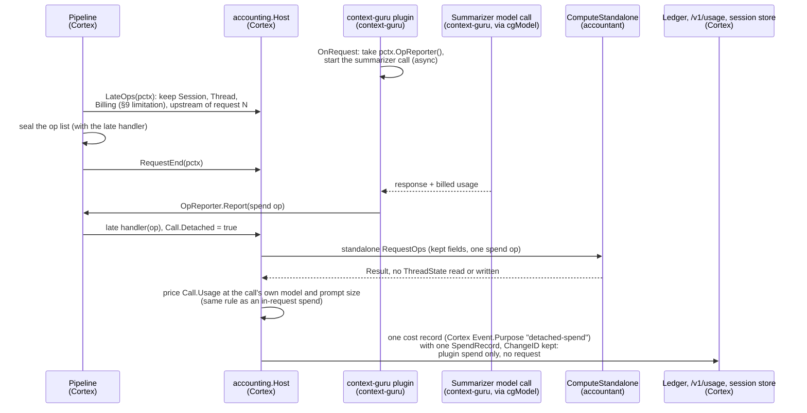
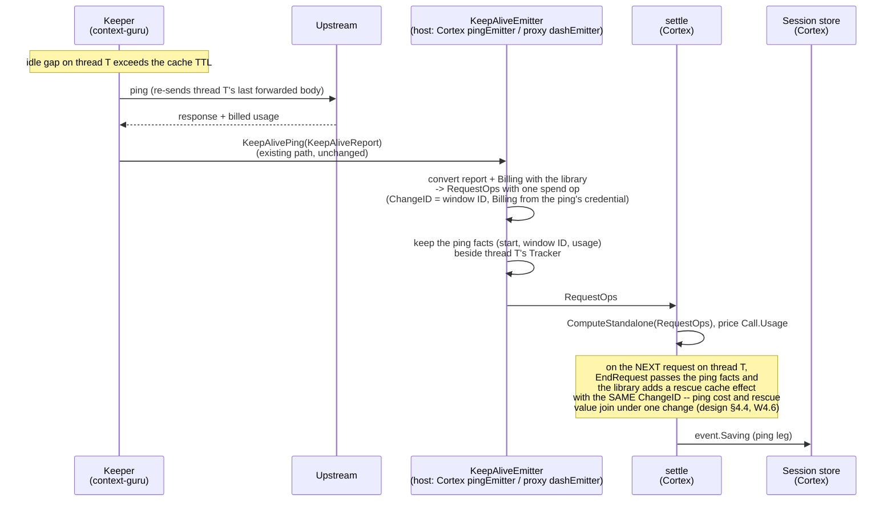

# Context operations: wiring in Cortex and the context-guru proxy

**Status:** implemented in the context-guru proxy: migration steps 1 to 5, with gaps in step 4, and part of
steps 6 and 10 (W9). Proposed for Cortex (steps 7 to 11). The proxy pins `accountant` v0.1.2. Status checked on 2026-11-17 against context-guru `b87af32`.
**Reference implementation:** the context-guru proxy. [W6](#w6-host-obligations-what-the-context-guru-proxy-does)
lists what the proxy does that the method documents leave to the host. A Cortex host must make the same
choices, or record why it does not.
**Companion:** [`spec.md`](spec.md) (what the system must do) and [`design.md`](design.md) (how) in this repository define the
method (the context operation model, the counterfactual, the tiers). This document says how Cortex and the
context-guru proxy connect to it. A plain `§N` reference points at the method documents. They share one numbering, and [the map](spec.md#numbering-map) says which of the two holds §N. Sections that start with `W` are this document's own.

**Problem statement:** [rossoctl/cortex#1417](https://github.com/rossoctl/cortex/issues/1417).
**Roll-up:** [rossoctl/rossoctl#2649](https://github.com/rossoctl/rossoctl/issues/2649), "Cortex Local:
Context Guru integration with Cortex". It asks that the accounting of context-guru match the pattern of
tool-prune, [rossoctl/cortex#952](https://github.com/rossoctl/cortex/issues/952) (closed). W7.4 compares
the two.

**Open.** The open questions that touch this document are in [design §11](design.md#11-open-questions):
question 8 (the Cortex names
`pctx.ReportOps` and the ledger writer), and questions 11, 13 and 14 (what the Tracker's state holds,
how it recovers, concurrent requests). The call sequence is in [design §6.1](design.md#61-call).

## W0. Overview: from a request to the savings


The request (black line) goes from the agent through the plugins to the upstream LLM. Each plugin
reports the context operations it made (circles). Cortex adds them to the request record, in pipeline
order. The record holds the client and forwarded bodies; the thread's Tracker holds its previous
fingerprint and its active context operations. `Compute` compares the two, applies the active
operations again, and returns tokens per tier. Cortex prices them with its own rates (W7.1). The sections below
give the details of each step.

### W0.1 The questions in cortex#1417

[cortex#1417](https://github.com/rossoctl/cortex/issues/1417) lists the open questions from the
Cortex side. This document answers them as follows.

| # | Question in the issue | Answer in this spec |
|---|---|---|
| 1 | One set of numbers: spend and savings priced from different rate tables | Inside one host, spend and savings use one resolver (D3, D4, W4.6). The tier logic is in one library. The rates stay host-local by design (§1). |
| 2 | A figure deployers can trust: how it was computed, and who stands behind it | Each recorded figure names its context operator, its component, `Estimated` and `DryRun` (W7.1), and the `accountant` version that computed it (R46). The rules are reviewed in this repository through the case list, and each host reviews its own differences (testing §10.2, §10.4). |
| 3a | Cache effects: a saving priced at the tier the rewritten request landed in | Saved tokens are priced at the tier they would have had without the change: B\* and the breakpoints (§5.1, R36, R37). A break that a change caused is a separate cache effect, a cost linked to that change (R23). |
| 3b | The plugin's own LLM calls through `core/llmclient`, not in the ledger; the `ibac` judge too | `spend` context operations with the call's billed usage (D4, W4.6). This applies to every plugin that calls a model, not only context-guru (R47). |
| 3c | Keep-alive: the cost and the benefit land on different requests | a `spend` per ping, a `rescue` cache effect, one `ChangeID` (design §4.4, W4.6). |
| 4 | Content re-sent every turn: overcount for compaction, correct for tool-prune | `ChangeID` (R22, D1); the tier comes from the position, so tool-prune is priced on every turn and a compaction is not counted again at the full rate (design §4.6). |
| 5 | Two ways of counting tokens | None: a context operator reports bytes only, the library converts them with the request's ratio and marks the result `Estimated` (R8, design §4.2 rule 7); the accuracy of the ratio is open (design §11, question 3). |
| 6 | Credit across several plugins | Each context operator is measured against its own input (R29), and R25 for the same content. |
| 7 | Observe mode | `DryRun` (R12), never counted in totals. |
| — | Where the baseline lives, and how changes to it are reviewed | In the `accountant` library, in its own repository (D2). A change to it changes the case list, and every intended difference a host has is recorded with that host's tests (testing §10.2, §10.4). |

### W4.6 How context operations reach the host

There are three kinds of context operator, and each reaches the host through a path that already exists.
The design adds no new reporting interface for the engine or the keeper. The last row is not a fourth
kind of operator: it is a model call of an engine or a plugin that finishes late. In Cortex it needs one
new host capability, `pipeline.LateOpsAccountant`, and no new interface for the plugin.

| Context operator | When it runs | How its context operations reach the host |
|---|---|---|
| **The context-guru engine** (every component, including the ones whose bytes `apply` writes, §4.2 rule 8) | inside a request | **`apply.Result.Ops`**: the engine returns its context operations with the rewritten body, in both hosts. In Cortex the context-guru plugin passes them to `pctx.ReportOps(result.Ops...)`. In the proxy there is no other context operator, so the proxy reads `result.Ops` directly. |
| **Another Cortex plugin** (tool-prune, cpex) | inside a request | `pctx.ReportOps(ops...)`, during its own pass. Cortex only. |
| **The keeper** | between requests | the host's `components.Emitter`, through its optional capability `KeepAliveEmitter.KeepAlivePing(KeepAliveReport)`. |
| A **detached** model call (engine or plugin) | after the response (in Cortex: after the op list is sealed) | In Cortex (proposed in cortex#2140): the same `pipeline.OpReporter.Report` as an in-request call. The pipeline sends a report that comes after the seal to the accountant host (`pipeline.LateOpsAccountant`, W4.8 B). In the proxy: `OpsEmitter.Ops(RequestOps)`, an optional `Emitter` capability (not built). |

**Why not a new `Sink`.** A `Sink` interface for pings would duplicate what exists. The keeper already
has a host-agnostic report path: `components.KeepAliveEmitter`, added so the keeper could be
exported from the proxy without a direct call into `dash` (issue #382, PR #591). The proxy wires
it to its `dashEmitter`; Cortex wires it to `pingEmitter` (`core/plugins/contextguru/spend.go`). A
second interface would make the keeper report each ping twice, or retire `KeepAliveReport` and lose
the fields the dashboard groups by (`Strategy`, `Preset`, `StopReason`, `MaxTokens`,
`FreshInput`). So the keeper keeps reporting `KeepAliveReport`, and **each host converts it** to a
`RequestOps` with one `spend` context operation:

| `KeepAliveReport` | `spend` context operation |
|---|---|
| `Session`, `Thread` | `RequestOps.Session`, `RequestOps.Thread` (`""`, the primary thread in `internal/thread`, becomes `"main"`) |
| `Window` (new, additive: the start of the idle gap the ping served) | `ChangeID = accountant.PingWindowID(Thread, Window)`: `"ka:" + thread + ":" + Window` in RFC 3339 UTC, with `""` as `"main"` |
| `Model` | `Call.Model` |
| `Route` (the upstream the ping was sent to) | `Call.Host` |
| `Provider` | not on the context operation; the host uses it to choose the lifetime kind (design §5.2) |
| `CacheRead`, `CacheWrite`, `CacheWrite1h`, `FreshInput`, `Output` | `Call.Usage` (its prompt fields and `Output`) |
| `TS` | `RequestOps.At` |
| `Strategy`, `Preset`, `StopReason`, `MaxTokens`, `Agent` | not on the context operation; the dashboard keeps reading them from `KeepAliveReport` (spec §9.1) |
| `CostUSD` | not used: the host prices `Call.Usage` with its own rates, like every other call |

The conversion is `accountant.PingOps`, a pure function. The library cannot import a host type, so the
host first copies its `KeepAliveReport` into an `accountant.Ping` (the table above says which field goes
where). `PingOps(ping, billing)` returns a `RequestOps` with one `spend` context operation, so both hosts
build the same context operation. The host supplies `Billing`, because only it knows which credential
the ping used. The host prices the result with `ComputeStandalone` (design §6.1). `Ping.ThreadID` `""` is
the primary thread, and `PingOps` maps it to `"main"`.

**The ping facts for the next request.** The same conversion returns the facts the next real
request of the thread needs, as `accountant.PingFacts`: the ping's start time (`LastPing`), its
`ChangeID` (`PingWindow`) and its usage (`PingUsage`). The host keeps the last of them beside the thread's
Tracker, and copies them into that request's `EntryFacts` with `PingFacts.Apply` at its `EndRequest`.
Then it clears them. The library derives the extent the ping read (`PingRead`) from the usage, because
the keeper replays the previous request's body (design §5.2). A host that knows the extent sets
`PingRead` itself. A ping does not move
the thread's `ThreadState`.

**The shared prefix (R54).** At the same `EndRequest` the host also sets `EntryFacts.SharedWarm`. It looks at the
other threads of the same session and finds the longest prefix of this request's forwarded body that one of
them read or wrote inside the TTL before this request. It uses only each thread's last request time and
cache extent, and compares body hashes. It stores no content. Without a sibling, it leaves `SharedWarm` nil.
`SharedWarm` is a position in the forwarded body of this request, and only a ping rescue reads it. Like the
ping facts, it is for one request: the host sets it again at each `EndRequest` and does not carry it over.
A position that is not in the forwarded body is a host bug: the library adds a `shared_warm` check failure
(`Result.Checks`) and credits no rescue.
The host chooses the siblings (the other threads, inside the TTL, not later than this request) and keeps their last
forwarded body and breakpoints. `SharedWarmFrom(fwd, siblings)` then returns the position: the last breakpoint that a
sibling sent inside the prefix it shares with this request. A shared prefix with no such breakpoint was not kept warm. A sibling that sent no breakpoint at all (automatic prefix caching) kept the whole shared prefix warm: with no breakpoint every position is one (design §5.1). The
function reads `Body` only, so a host does not read `Body.Start` or `Body.Pos`.

**The billed lifetime.** `EntryFacts.TTL` is written at `EndRequest`, before the response, so it holds the lifetime the
request asked for. A gateway can bill a 1h ask as 5m. When the host learns this from the usage, it calls
`Request.LowerTTL(5 * time.Minute)` before `Compute`. The library lowers the TTL of the facts and of every 1h
breakpoint, in the forwarded body and in the client body, so the entry is a 5m entry (accountant#56). `LowerTTL` only lowers, and it does
nothing before `EndRequest`. A host cannot change the record in any other way, because `Request` has no exported fields.
A host that does not call it gets a figure that is wrong in both directions, not only high (design §4.4, cortex#2136).

**Status (2026-11-26).** cortex#2140 proposes how Cortex books a detached call (W4.8 B). It is not
merged. The plugin needs no new interface, because the pipeline knows when a report is late. The proxy has no pipeline, so it needs the
`OpsEmitter` below. `OpsEmitter` does not exist in context-guru (checked at `b87af32`), so the proxy
reports no detached call yet. The interface below is the proposal for the proxy.

```go
// OpsEmitter is an optional Emitter capability, the same pattern as KeepAliveEmitter: the engine
// type-asserts for it and does nothing if it is absent. It carries a RequestOps that has no
// request to travel with: today, only a detached model call.
type OpsEmitter interface {
    Ops(RequestOps)
}
```

The contract of both capabilities: safe for concurrent use; no
blocking I/O; never makes the session active (a ping is not agent activity); may drop a report for
a session that no longer exists.

**The two Cortex report calls.** `pctx.ReportOps(ops...)` reports on the request goroutine, during
the plugin's own pass. `pctx.OpReporter()` returns a handle that keeps the plugin's name and its
dry-run state. Its `Report(ops...)` adds to the same op list as `ReportOps`, and is safe from any
goroutine. A plugin takes it during its pass, for a model call that it makes on another goroutine.

**The `ibac` judge and other plugin calls (R47).** A plugin that calls a model through `core/llmclient` wraps the client the host gives it, as `cgModel` does, so that the call's billed usage fills a `ModelCall`. The plugin reports a `spend` with an empty `ChangeID`: through `pctx.ReportOps` when it reports during its pass, or through `OpReporter.Report` from another goroutine. In Cortex the same `Report` also works when the model call is detached: the pipeline sends a late report to the host (W4.8 B).

**Who builds a standalone `RequestOps`.** No request record is open, so the caller fills it from what it
knows about the thread it acts on: `Session` and `Thread`. It sets `Billing` from the credential its
call used (R41, R42, design §7.1). One exception: a detached call in Cortex. It is reported as a
`spend` of its request, which has no payer of its own, so the host sets `Billing` from that request.
This is the known limitation of spec §9 ("the payer of a call is the payer of its request"). It is
the same as for that call when it finishes inside the request.

**Where the usage comes from.** The host gives the engine its model client (`components.Model`;
in Cortex, `cgModel`). The client reads the usage from each response, and fills `ModelCall`. The
engine's own usage accounting is not used, because under Cortex it is zero (2026-10-14 spec, §0).

**A detached call.** A summarizer call can finish after its request was answered. Its `spend`
context operation then cannot travel in that request's `apply.Result` or op list. The host prices it
as a standalone `RequestOps` with `ComputeStandalone`, with `Detached = true` on the call, and
`Session`/`Thread` from the request that caused the call. `Billing` follows the rule above. Its
`ChangeID` is the change it made, so the cost is still joined to that change.

**When `Detached` is set in Cortex.** Cortex seals the op list when the last plugin's request pass
ends, before it sends the request upstream. So Cortex sets `Detached` on every call that finishes
after the seal. This includes a call that finishes after the seal but before the response. That is
earlier than "after the request it served was answered" (`ModelCall.Detached`, design §ModelCall).
The price is the same either way: `ComputeStandalone` prices a call by its own usage, and the
request's `Compute` does not read a spend's usage to find a cache effect.

- **In Cortex** (proposed in cortex#2140), the pipeline builds nothing new for the plugin. `Run`
  seals the op list right before `RequestEnd`. Before the seal, it asks the host for a late handler
  (`LateOpsAccountant.LateOps(pctx)`). The host keeps the session, thread, billing, upstream and
  client of the request there, on the request goroutine. An op reported after the seal goes to that
  handler, and the pipeline sets `Call.Detached`. The seal and the handler are under one lock, so an
  op goes to `RequestEnd` or to the handler, never to both.
- **In the proxy**, the engine sends it through `OpsEmitter` (not built).

**A prefix ask.** `extract_llm_sweep` asks the request's own model a question, as a separate
upstream call whose body is the previous turn's forwarded bytes plus one trailing user message
(`PrefixAsker`). That is an ordinary `spend` context operation: its `Call.Usage` shows the cache read it
was designed for (measured 19,595 read, 0 written). When the sweep falls back to a call without the
cached prefix, the same context operation shows fresh input instead. No new kind is needed; the test cases
cover both (testing §10.3).

**How the host records it.** The host handles context operations from `apply.Result`, from `ReportOps`
and `OpReporter.Report`, from the Cortex late handler, and from either Emitter capability the same way. It prices `Saved`, `Caused` and `Call.Usage` with
one resolver. So spend has the same rates, provenance, currency and billing basis (design §7.1) as the
savings.

**What it replaces.** `core/cost/spend` (`Charge`, `CostRecorder`, `RecorderConsumer`) is removed.
Today both Cortex wirings inject `spend.LogRecorder{}`, which only logs, and the recorder that would
write the ledger was never built. So no recorded figure changes. Cortex's `pingEmitter` keeps
implementing `KeepAliveEmitter`, and converts each `KeepAliveReport` into a `spend` context operation with the library, instead of building a `spend.Charge`.

### W4.8 Sequence: three flows, and which repo each step is in

`participant` labels mark which repo owns each piece: Cortex (the pipeline, the Tracker,
`settle`) or context-guru (a plugin, the keeper, `accountant`). `accountant` is a library import in both; it
runs in-process in whichever repo calls it, never as its own service.

**A. A normal request.** A plugin reduces a tool output; `Compute` finds no break; `settle`
prices and records.

```mermaid
sequenceDiagram
    participant Client
    participant Pipeline as Pipeline<br/>(Cortex)
    participant Tracker as Tracker<br/>(accountant, imported)
    participant Plugin as context-guru plugin<br/>(context-guru)
    participant Ops as request.Compute<br/>(accountant)
    participant Settle as settle<br/>(Cortex)
    participant Store as Session store<br/>(Cortex)
    participant Upstream

    Client->>Pipeline: request
    Pipeline->>Tracker: BeginRequest(meta, client body, client breakpoints)<br/>(Session, Model, Billing from credential; no thread yet)
    Pipeline->>Plugin: OnRequest(pctx)
    Plugin->>Plugin: apply.Apply: resolve thread,<br/>rewrite a tool output (mask/cmdfilter/coref/...)
    Plugin->>Pipeline: pctx.ReportOps(result.Ops...)<br/>+ result.Thread
    Pipeline->>Tracker: Request.Add(op) for each<br/>stamps Operator and DryRun
    Pipeline->>Tracker: EndRequest(thread, forwarded, breakpoints, facts)<br/>copies that thread's ThreadState
    Pipeline->>Upstream: forward (smaller) body
    Upstream-->>Pipeline: response + usage
    Pipeline->>Ops: request.Compute(usage)<br/>compares inside: B*, cache effects, phase
    Ops-->>Pipeline: Result (PricedOp[], CacheEffects[], Boundary, Phase)<br/>and the new ThreadState is stored
    Pipeline->>Settle: Result
    Settle->>Settle: price Saved/Caused with pricing.Resolver
    Settle->>Settle: discard RequestOps/Operation (R20)
    Settle->>Store: event.Saving{Changes: []ChangeSaving, ...}
    Pipeline-->>Client: response
```

**B. A detached call.** The request's op list is already sealed. The summarizer call finishes
afterward and reports through the same `OpReporter` as an in-request call. The pipeline sends the
late op to the host's handler. This is the Cortex flow that cortex#2140 proposes (not merged). The
proxy would send a standalone `RequestOps` through `OpsEmitter` instead (not built).
`accounting.Host` is the Cortex accountant host. Flows A and C show its pricing step as `settle`;
diagram B shows the host, because the late handler is on the host.



**C. A standalone keep-alive ping.** No request is open at all; the keeper acts between turns.



## W5. The Tracker and the host

**Current design.** The Tracker in the library keeps the state of each thread: the active context
operations, the previous fingerprint and the cache state. The host owns one Tracker for each thread,
and calls it (design §6.1). The alternative, a push model, is not pursued (design §11, question 4, decided).

Each host does the same: Cortex, and the context-guru proxy. The parts are split this way. The parts that live in the library are in the method document (design §5).

| Part | Where | Cortex | Proxy |
|---|---|---|---|
| Resolve the thread | the engine's thread resolver (`internal/thread` there) | the engine resolves it inside `apply`, as today, and returns it in `apply.Result.Thread`. If the context-guru plugin is not in the pipeline, the host calls `internal/thread` itself on the client body | the same |
| Collect the context operations | host | `pctx.ReportOps`, from every plugin, in pipeline order (W5.1) | `apply.Result.Ops`: the engine is the only context operator |
| Keep the thread's state: active context operations, previous fingerprint, cache state | the Tracker (library); the host holds one Tracker for each thread | a map from `thread.Key(session, thread)` to its Tracker | the same map, beside `dash.Recorder`'s `lastTail` (W5.2) |
| Find B\*, the break and the cache state | inside `Compute` (deterministic; the comparison is not public) | calls `BeginRequest` before the plugins and `EndRequest` with the resolved thread after them, then `request.Compute(usage)` after the response, which stores the new `ThreadState` | the same calls |
| Keep the last ping facts of each thread | host, beside the Tracker | in `pingEmitter` | in `dashEmitter` |
| Convert keep-alive reports | the library's keep-alive conversion (pure) | in `pingEmitter` | in `dashEmitter` |


### W5.1 Collecting

- Each plugin calls `pctx.ReportOps(ops...)` during its pass. The pipeline runs in sequence, so the
  list is in order.
- The framework sets `Operator`. A plugin cannot report under another plugin's name.
- The framework sets `DryRun = true` on every context operation of a plugin whose `SetBody` returned
  false (`on_error: observe`).
- A context operator reports only changes that are in the forwarded body, or that would be there for a
  `DryRun` context operation. A change the pipeline reverted (an error, a panic, the never-worse guard) is
  not reported. It saves nothing, as a change that ended (§4.5). Its model call, if any, is still a
  `spend` context operation, so the money it cost is counted.
- The host keeps an explicit allow-list of context operators, for the reason `savingComponents` has today:
  a plugin must not add itself to the money record only by reporting context operations. Context operations from
  a context operator that is not on the list are kept on the event and marked unpriced. The library
  does not see the list. So the host, not the library, writes the reason `operator_not_allowed`:
  it drops those `PricedOp`s from the money record after `Compute`. They still go to `Add`, because
  the sum check needs every change in the body.

### W5.2 The thread, and the previous request

**The thread comes from `internal/thread`, not from the Tracker.** The engine already resolves
each request's thread (`thread.Result`): the agent's header first, then prefix continuity, then the
session as a last resort. It also returns two signals that a weaker rule would lose:

- `Disagree`: the header named a known thread, but prefix continuity matched a different one. The
  header wins; the host logs the drift.
- `Inherits`: a new thread whose content is mostly an existing thread's — a rewind, an edited
  earlier message, a fork. Its first request is that thread's next turn, not a cold start.

The engine runs inside both hosts, so both get the same `thread.Result` for the same traffic. `RequestOps.Thread` carries
`ID` and `Parent` (`Parent = Inherits`).

**The previous request is this thread's previous request.** The host keeps one Tracker per
thread, keyed by `thread.Key(session, thread)` — the key `dash.Recorder` already uses for
`lastTail` and `lastSeen`. A new thread with `Inherits` set starts from a copy of the inherited
thread's `ThreadState`: its fingerprint, so a fork reads its parent's cache instead of scoring cold,
and its active context operations, because the fork carries the parent's content and the changes on
it. From then on the two threads are separate. A change that ends in one does not end in the other.

An earlier draft matched each request against the last 4 fingerprints of the session by longest
common prefix. That answered a weaker question. After interleaved subagent requests the best prefix
match can be an older request, and a main thread whose previous turn is more than 4 requests back
drops out of the window. `cachesplit`'s saving depends on comparing the volatile tail with **this
thread's immediately previous request** (`cachesplitSavedUSD`, `TailChanged`), so a stale match
would misattribute it. Keying by thread gives the right baseline for every rule that needs one.

### W5.3 Limits

- **Memory:** 16 bytes for each position (`PosHash`, design §5.1). 2 bodies × 2,000 positions is about
  64 KB for each thread. `internal/thread` caps threads at 64 for each session; a typical session
  has 1 to 5. The `Trackers` bound themselves: above 10,000 threads, `BeginRequest` drops the ones seen
  longest ago, down to 9,000 (design §6.1, Memory). `Trackers.Trimmed` counts the dropped threads. The host
  calls nothing for this. A host can bound its own stores tighter, as Cortex does with
  `session.max_sessions` (100), but that does not bound the `Trackers`.
- **What is kept:** one fingerprint for each thread, the last one, overwritten after each request. B\*
  needs only the previous request of the same thread, so the store does not grow with the length of a
  session. The active context operations of a thread are also kept, because `Compute` applies them
  again. They grow with the number of live changes, not with the number of requests, and a change that
  ends is removed. `Compute` infers the end from the bodies and the splice (design §11, question 12,
  decided). A change whose end the rule does not find stays in the list until its thread is dropped.
- **A failed request:** the reported changes are stored at `EndRequest` (design §4.6), so a request that never reaches `Compute` does not lose them. The host does not need to call `Compute` for it.
- **Restart:** the host saves and loads the state of every thread with `Trackers.Snapshot` and
  `Trackers.Restore` (design §6.1). The library does no I/O. The host chooses where the bytes go. The
  snapshot holds hashes, sizes and IDs, no message text (R2).
  - The proxy saves every minute and at shutdown, to `<dashboard DB>.accountant-state.json`. It has no
    file for an in-memory DB (`proxy/accountant_state.go`, `proxyapp/main_run.go`).
  - At start, the proxy refuses a snapshot older than 1h. It also refuses a file whose wrapper version is
    not its own. The proxy changes that version whenever its body hash changes (context-guru#917).
  - **The 1h age limit is a proxy choice, and it has a cost.** Its reason, that no cache entry outlives
    the longest TTL, covers only the cache state. The snapshot also holds the active changes. After a
    stop longer than 1h, every thread loses them, as with no snapshot (below). `Compute` already judges
    an old `PrevPrint` by the gap: a gap past the TTL gives a cold or unknown phase. So a host can restore
    a snapshot of any age, if its body hash has not changed. The library has no idle timeout for a close
    reason (design §6.1).
  - Cortex must save and restore the state. Without it, every restart loses the active changes of every
    live session. Do not copy the 1h limit without a reason.
- **Restart without a snapshot** (a crash before the first save, or a host that does not save): the whole
  `ThreadState` is lost. The fingerprint heals on the next request: only that request gets
  `penalty_unknown`. The active context operations do not heal: the context operators do not report
  them again, so every later request of the thread misses their saving and fails the sum check, until
  each change ends (design §4.6). How the state recovers in this case is open (design §11, question 13).
- context-guru keeps its own `MaxCachedIdx` for its own decisions. For pricing, the library's B\*
  is the only authority (R30), because it is computed from the forwarded body after every plugin
  ran. In the proxy there is no later plugin, so the two must agree. The plan was that the proxy checks
  `MaxCachedIdx` against B\* and counts a disagreement (a bug in one of them). **Not built:** the proxy
  does not read `Result.Boundary`, and it has no such counter (checked at `b87af32`).

## W6. Host obligations: what the context-guru proxy does

The method documents say what the library does with its inputs. They do not say how a host prepares
those inputs, when it calls the library, or when it accepts the figure. The context-guru proxy made
these choices, mostly while it fixed bugs. This section lists them, so that Cortex can make the same
choices or record why it does not. Paths are in context-guru, at `b87af32`. Issue numbers without a repo
are context-guru issues.

### W6.1 When to call `Compute`, and when not to

| Case | What the proxy does | Why | Where |
|---|---|---|---|
| The status is not 2xx, and not 0 | No `Compute`. The fallback reason is `no_result`; the `acc_fallback` log names `rejected_status`. | The provider billed nothing, so the request saved nothing. A 4xx or 5xx body can still carry a usage object. Status 0 (no provider reached) is not a rejection. | `proxy/dashcapture.go` (`finish`) |
| The request took more than one upstream round | No `Compute`. The fallback reason is `no_result`. | The proxy answered a `context_guru_expand` call itself and sent the request again. One usage object then covers more than one body. | `proxy/dashcapture.go`, `proxy/ssepeek.go` |
| A tool deferral could not be described to the library | No `Compute`. The fallback reason is `no_result`; the log names `deferral_unplaced`. | The sum check would fail on the bodies as they are. | `proxy/dashcapture.go`, `proxy/accountant_billed.go` |
| An OpenAI Responses request whose history the provider holds (`previous_response_id`, `conversation`, `item_reference`) | No record at all (`server_held_history`). | The body holds only this turn. The library would read the missing history as a client edit (#899). | `proxy/proxy.go` (`responsesServerHeldHistory`) |
| No session | No record. | The thread key needs a session. | `proxy/proxy.go` |
| A panic before the forward | `drop` the open record. | A record that never ends must not stay in memory. | `proxy/proxy.go` (`accDrop`) |
| A panic in `Compute` or in ping pricing | Recover, log, book no figure. The fallback reason is `no_result`; the log names `compute_panicked`. | The keeper runs pings in its own goroutine, so a panic would end the process (#918). | `proxy/accountant_savings.go` (`computeSafe`), `proxy/accountant_ping.go` |

### W6.2 When the calls run

1. **Before the pipeline**, the proxy keeps the client body. The session is known only after the
   pipeline, so `BeginRequest` runs later. It still gets the body as it was before any change.
2. **After the last change and before the upstream call**, the proxy starts a goroutine. That goroutine
   calls `BeginRequest`, `Add` for every operation and `EndRequest`. This keeps the hashing off the
   request path (#1059). Last changes means the expand and adjudicate injection and the tool deferral.
3. **After the response is flushed**, the proxy waits for that goroutine. It then calls
   `Request.LowerTTL` when the usage shows a 1h ask billed as 5m (W6.6), then `Compute`, then the metrics
   observer (W6.7).
4. The proxy does not order the `Compute` calls of one thread. It relies on `Result.Recomputed` (design
   §6.1, R53).

### W6.3 How the proxy builds a `Body`

- **Sections.** The order is tools, system, messages. A string system prompt is one position. On the
  Responses wire, `instructions` is the system section and each `input` item is one message position
  (`proxy/accountant_savings_body.go`, #899).
- **The hash leaves out `cache_control`, the size keeps it.** The provider's cache key ignores the marks,
  and a client moves its marks every turn. With marks in the hash, the library finds no common prefix
  after the system block (accountant#21). Nested marks, such as one inside a `tool_result` block, are
  left out too (#917).
- **Sizes are wire bytes.** The proxy overwrites `Pos[i].Bytes` with the size of the JSON it sent. It then
  builds the value again from `Start` and `Pos` only. That drops the unexported cumulative table that
  `NewBody` makes from the input without marks. Then every byte count the library reads is a wire size,
  as the operation sizes are (#893). A body from a snapshot has no table either, so a restart changes
  nothing.
- **Breakpoints.** One for each position. If one position has two marks, 1h wins over 5m.
- **The body hash is versioned.** The state file has a wrapper version (W5.3). Change it whenever the
  body hash changes. Otherwise a restored state compares bodies hashed in two ways.

### W6.4 Which operations the host builds

The engine returns the operations of its components (`apply/ops.go`). Every operation is `KindRewrite`,
with `Operator = "context-guru." + component`. `DryRun` is set when the change was not applied, or in
observe mode. The only `spend` operations come from `PingOps`. The proxy adds these:

| Operation | `ChangeID` | Where |
|---|---|---|
| A change of one message | `cg:<component>:<index>:<hash of the client text>` | `apply/ops.go` |
| The tail breakpoint mark | `cg:tailbreakpoint:<hash>`. It is reported even when the other operations were dropped, because otherwise the sum check fails by the mark's bytes (accountant#70, case C). | `apply/ops.go`, `apply/apply.go` |
| A restored output (`expand_restore`) | `cg:restore:<anchor>`. A `MessageSplice` that inserts one message. | `apply/restore.go` |
| Tool declarations removed, added or rewritten | `cg:<component>:decl-removed:…`, `decl-added:…`, `decl-rewritten:…`. Removed declarations are one operation with `Spans` in `SectionTools`. | `proxy/accountant_envelope.go` |
| The system prompt rewritten | `cg:<component>:system-rewritten:…` | `proxy/accountant_envelope.go` |
| A cache mark relabelled in place to another lifetime (`headttl`) | `headttl:<hash>`, with no `cg:` prefix. It is its own operation, so the library can book its premium (W7.1). | `proxy/accountant_envelope.go` |
| The cache split | `cg:cachesplit:<hash>` | `proxy/accountant_envelope.go` |
| A message inserted or rewritten by the tool deferral | `cg:tooldefer:msg-inserted:<i>`, `cg:tooldefer:msg-rewritten:<i>:<hash>`. Operator `context-guru.tooldefer`. | `proxy/accountant_envelope.go`, `proxy/accountant_wire.go` |

Rules the proxy follows:

- **Sizes are wire bytes.** The engine measures text. `wireSizes` converts the text sizes to the bytes
  of the JSON sent. When more than one operation touches one message, it chains them, so each
  operation's `SizeBefore` is the previous operation's `SizeAfter`. If the net change is not
  `inTotal − outTotal`, it drops every operation and sets `OpsDropped` (`apply/ops.go`).
- **Splices cover whole messages.** A splice must cover whole wire messages with no holes.
- **A metadata-only mark write counts as a change.** Otherwise its operation is dropped and the sum
  check fails on the added bytes (#938).
- **Envelope operations describe the billed body** (R56). The order is the pipeline operations first,
  then the envelope operations (`proxy/accountant_wire.go`, `proxy/accountant_billed.go`).
- **Every operation goes to `Add`,** replays too. The library needs every change in the body for the
  sum check.

### W6.5 When the host accepts the figure

`dash.Event.PriceMode` (`dash/accountant_price.go`) tests these gates in order. The first one that fails
gives the fallback reason. The proxy then books its own figure and logs `acc_fallback` with the reason,
the checks and `Recomputed` (`proxy/accountant_shadow.go`). A request whose `Compute` was skipped (W6.1) gets
`no_result`, and the log line names the detail.

1. `unpriced`: no complete usage, or no price for the model. This test runs before every other gate, so a
   request with no usage is `unpriced`, not `no_result`.
2. `server_held_history` (W6.1).
3. `no_result`: no `Result` (a skipped `Compute`, more than one upstream round, a panic).
4. `ops_dropped`: a change could not be placed as an operation.
5. `observe`: the run was in observe mode.
6. A fatal check (`CheckFailure.Fatal`). `CheckSum`, `CheckUniqueChange` and `CheckSpans` have their own
   reasons. Any other fatal check is `check_other`.
7. `unpriced`: an unpriced operation or cache effect. The exception is `ReasonPenaltyUnknown`. It does
   not fail the gate. The figure is marked estimated and held in `EstimatedSavedUSD`, outside every total
   (#915).
8. `implausible_size`: the library saved more tokens than the request had. A host gives no size, so the
   library measures it. The bound leaves out the
   operations of `toolfilter`, `toolschema`, `expand`, `adjudicate` and `tooldefer`, because
   the size counts message text only (#907). It leaves them out by operator, so the `tooldefer`
   operations on messages are left out too.
9. `figure_without_row`, `duplicate_name`, `acted_without_figure`: the figure and the component rows do
   not match.

Gates 6 to 8 are `accountant.Withhold` (design §6.7). Gate 6 skips a `sum` failure in a section that no
applied operation claims (`CheckFailure.Claims` 0): a host plugin changed that section and reported nothing,
and the other operations are still right. Gate 7 includes a cache effect of an unknown kind.
The size bound adds the tokens the operations caused, because an operation can remove what an earlier one
inserted. The library has them, so the `metrics` sink gates a
request the same way: it books only the spends of a withheld request, and counts it in
`llm.savings.withheld`. `Withhold(res)` measures the size itself and counts message tokens only, so a removed tool declaration
does not trip the bound (design §6.7). A host that has no better measure calls `Withhold(res)`. Cortex uses
gates 6 to 8, with its own size measure: the billed prompt, scaled by the bytes of the client and forwarded
bodies. It passes that size as the legacy argument. The context-guru proxy has two paths:
- **The dashboard and /stats gate** (`accrec.Gate`) calls `Withhold(res)`. It has no host size bound
  (context-guru #1529).
- **The metrics push** sends an `Observation` with no `TokensBefore`. The sink then calls `Withhold(res)`.
  So the library bound applies to the push as soon as the proxy uses this release.

How the proxy books what passes:

- It skips `DryRun` operations and `spend` operations. The first operation that has a `ChangeID` owns it.
- It books cache effects by `Kind` with `CacheEffect.Net`. This follows W7.1. An `EffectMarkPremium`
  or `EffectMarkPayback` with no owner goes to `tailbreakpoint` (accountant#52). A `break` marked
  `InBaseline` is shown and not counted.
- It ignores `Result.Interaction`. Cortex books it as `Event.InteractionUSD` (W7.1). So on a rescued
  request the session and thread totals of the two hosts differ by the interaction (W7.3).

### W6.6 Keep-alive pings, shared warmth and billed lifetime

- **Pings** (`proxy/accountant_ping.go`). The proxy refuses a ping that has a zero `Window`, a status that
  is not 2xx, or zero usage. `Ping.At` is the ping's start (`TS − DurationMs`). `Billing` is always
  `BillingAPI`.
- **Manual pings** are priced, but their facts are not stored. The saving of a manual ping is already
  booked on its own row. A stored fact would let the next request credit the same write again
  (#768 B3).
- **Ping facts.** A `PingStore` holds them, at most 4096 entries keyed by session and thread. The request
  reads the facts, and after `Compute` it drops them only if their `PingWindow` is the one it read. The
  proxy counts `cg_keepalive_rescue_facts_missing_total` when a request ended a gap with pings but found
  no facts.
- **Shared warmth (R54)** (`proxy/accountant_shared.go`). The proxy keeps the last forwarded `Body` and
  breakpoints of each thread: at most 4096 sessions, at most 64 threads each. The siblings are the other
  threads of the session, inside the TTL and not later than this request.
- **Billed lifetime** (`proxy/accountant_wire.go`, `proxy/accountant_tier.go`). `EntryFacts` starts as
  `TTL` 5m and `LifetimeUnknown`. `apply.CacheLifetime` (the cold gate's rule) sets `LifetimeExact` or
  `LifetimeMinimum` when it knows the provider. With `LifetimeExact`, `TTL` is 1h only when every breakpoint
  asks for 1h. When the usage shows that a 1h ask was billed as
  5m, the proxy calls `LowerTTL(5m)` before `Compute` (#919). A store of at most 8192 entries remembers
  each thread's billed tier (#1078). The rule (`accrec.BilledTTL`):
  1. A response that wrote to the cache bills its tier on the tokens it wrote: 1h only when all of them are 1h
     (`CacheWrite1h` = `CacheWrite`; check 8 refuses a larger `CacheWrite1h`). The thread remembers that tier.
     This step needs a host that fills `CacheWrite1h` from the bill. For a host that never fills it, every write
     looks like 5m.
  2. A response that wrote nothing keeps the thread's last billed tier. Without this step, the read-only turn
     after a downgraded write is priced at 1h again, and a `rescue` on it is too high.
  3. A thread with no write yet keeps the asked tier.

  **Cortex** applies the same rule in `Host.Compute` (`core/accounting/host.go`, `billedOneHour`, cortex#2142).
  It keeps the tier in its per-thread `threadBilling` entry, with the 10,000-thread bound, and counts each
  lowered request in `llm.cache.ttl_downgrades`. Neither host saves the tier in a snapshot.
- **Compaction (R55).** `RequestMeta.Compaction` is `CompactionUnknown` after a compaction that the
  proxy found by phrase match. Otherwise it is empty (`proxy/agentcompaction.go`).
- **Billing.** The proxy sets `Billing{Mode: BillingAPI}` on every request. It does not tell a
  subscription from an API key. Cortex must set it from the credential by the rule in design §7.1,
  using the library's `accountant.BillingFrom`. The proxy itself still hard-codes `BillingAPI`
  until it adopts `BillingFrom` too (tracked in Cortex's own `docs/accounting-differences.json`).

### W6.7 Metrics

The proxy uses `github.com/rossoctl/accountant/metrics` ([metrics.md](metrics/metrics.md)):

- `acmetrics.New(meter, pricer, WithComponents(...))`. The pricer maps each tier to the
  `modelinfo` rate. An unknown model returns an estimated zero (`proxy/metricsink.go`).
- `Observer.Observe` after each `Compute`, with a panic recovery. Also for each priced ping, with an
  empty `RequestID`.
- The OTel push runs only with `--dashboard` and `--metrics-push-url` (`proxyapp/metricspush.go`).

## W7. Recording and totals

### W7.1 From `Result` to `event.Saving`

`settle` calls `accountant.Compute` once for each request, over the in-process `RequestOps`/`Operation`
list (R20): that list is never recorded. `settle` prices `Saved` and `Caused` with its
`pricing.Resolver`, at the same model and long-context tier as the request itself, then discards
the context operations and writes one `event.Saving` for each (context operator, component) — the only form that
reaches the session store, `:9094`, and the archive.

A cache effect (`Result.CacheEffects`, design §4.4) is not an operation and has no `Operator`. `settle`
settles it by its `Kind`. A `break` with a `ChangeID` goes to the operator of the `rewrite` or `setting`
with the same `ChangeID` in the result, reported or active. A `rescue` goes to the keeper, by its window.
A `ttlPremium` and a `ttlRescue` go to the head entry named by their `ChangeID`. A `ttlPremium` with no `headttl:` ChangeID is the 5m to 1h upgrade of a host's 1h breakpoint; it has the `ChangeID` of the reported operation that covers the breakpoint, or none, and the host books it with that operation, or as unattributed. A `break` with no
`ChangeID` goes to `Event.UnattributedBreakUSD`. A `markPremium` (the write premium of a breakpoint the host added) goes to the operator of the `rewrite` with the same `ChangeID`, and with none to the host's own account for the mark. It is a cost only. A `markPayback` is its return: it goes to the same operator or account, and it is a saving.

A `break` cache effect has both sides (design §6.3): `Saved.CacheRead` is the read that did not happen,
and `Caused.CacheWrite5m` is the write that happened instead. They are one fact, the rate
difference. So `settle` prices a break as **one net cost**, `Caused` priced minus `Saved` priced,
and puts it in `PenaltyUSD`. It never adds a break's `Saved` to `USD`, which would inflate the
saving by the read.

| `event.Saving` field | Source |
|---|---|
| `Component` | the context operator name, for example `context-guru.mask` (the existing field; `Saving.Operator` below is the same dotted name, kept as its own field so a reader can group by its first part) |
| `TokensAvoided` | kept for the display that reads it today: the bytes the operator removed (`SizeBefore.Bytes − SizeAfter.Bytes`), converted by the request's ratio (design §4.2 rule 7), always `Estimated`. The library does not return it; `settle` computes it. It is a size, not a price, and not the cross-tier total that R52 forbids: `USD` is the price |
| `USD` | `Saved` of the content changes and rescues, priced |
| `PenaltyUSD` | `Caused` of the content changes, priced, plus the net cost of each attributed break |
| `Tier` | the tier with the largest `Saved` |
| `Projected` | `DryRun` (the existing field: "would have saved", never in a total) |
| `Estimated` | any context operation `Estimated` |
| `OpsVersion` (new, additive) | `Result.Version`, the version of the `accountant` rules (R46) |

New fields, all additive (the ledger rule is "add, never rename"):

| Field | Where | Why |
|---|---|---|
| `Saving.Operator` | event and ledger | group `context-guru.*` in the per-plugin breakdown |
| `Saving.Changes []ChangeSaving` | event only | `{changeId, savedUSD, causedUSD}`, for totals and payback for each change. Not in the ledger, which keys by minute. |
| `Event.UnattributedBreakUSD` | event | client edits and expired caches. Shown, never charged to a plugin. |
| `Event.InteractionUSD` | event | the interaction on a rescued request (§6.2). Counted in the session total, never charged to a plugin. |
| `Saving.Thread`, `ChangeSaving.Thread` | event and ledger | sum for each thread; a subagent's saving is separate from the main thread's |
| `Saving.Basis` | event and ledger | `usd`, `subscriptionEquivalent` or `unknown` (design §7.1). Only `usd` goes in a money total. |
| `Event.Spends []SpendRecord` | event only | `{changeId, thread, costUSD, basis}`: one for each `spend` context operation of the request, priced from its `Call.Usage`. `basis` follows the same rule as `Saving.Basis`, so a ping on a subscription is not counted as money. A ping is its own `RequestOps`, so its event holds one record. |

`TotalAvoidedUSD` does not change: `max(0, USD − PenaltyUSD)` for each saving, floored at zero.

**No single token total** ([R52](spec.md#r52)). This is also the rule of tool-prune (cortex#952, `usage.go`). Tokens appear for each tier, and dollars appear in a total (W7.2).

**Zero is not "no data".** A request whose agent has no changes records an explicit `Saving` with
zero, or no `Saving` and a reason. A field that is absent must mean "not measured", never zero.
`event.Saving` fields that carry `omitempty` today do not meet this: a true zero is absent on the wire.
The display layer must be able to tell the two apart (open: W7.4).
That floor applies to the existing ledger total only. The totals of W7.2 are signed and are folded
from the recorded events, so a window that cost more than it saved shows as negative.

**Size.** `Saving.Changes` is already small per request — one `ChangeSaving` per change touched,
not per context operation — but a request can still touch many changes (a `coref` batch cut, a wide
`mask`/`cmdfilter` pass). So `Saving.Changes` has a size limit, with aggregation above it:

```go
// Aggregate replaces entries past the limit. One bucket per key, so a thread/session total is
// still exact; only each individual change's own cross-request total is lost for entries folded
// in here.
type Aggregate struct {
    Limit   int
    Dropped int // ChangeSaving entries folded into Entries
    Entries []AggregateEntry
}

type AggregateEntry struct {
    Operator            string
    SavedUSD, CausedUSD float64 // summed
}
```

### W7.2 Totals for each change across requests

A total for one `changeId` is a fold over the session's events: add `Changes[i]` where the
`changeId` matches. The session archive holds each request's event for the whole session, so agentop
can compute the fold when it opens a session. There is no ledger column for each change.

Without an archive (a cluster sidecar), totals for each change cover only the events in memory. The
per-request savings and the ledger totals are correct either way.

**Totals for a session and for a thread.** `Saving.Thread`/`ChangeSaving.Thread` carry the thread
(W7.1), so the same fold over recorded events gives:

| Total | Sum of |
|---|---|
| A change | `ChangeSaving`s with one `changeId` in one thread |
| A thread | every `Saving` of one `Thread`, plus its `Event.Spends` and `Event.InteractionUSD` |
| A session | every thread of the session |
| A subagent | the threads whose `Parent` chain leads to the main thread, one at a time |

A `spend` is shown beside the savings, never inside a `Saving`, as today. A keep-alive window's or a summary's net total joins its `SpendRecord`s and its `ChangeSaving`s by `changeId` when the fold is read; no stored field holds the net.

### W7.3 The context-guru proxy

The proxy computes its dollar savings from `accountant.Compute`. This is built (checked at `b87af32`):

1. The engine returns the request's context operations in `apply.Result.Ops` (migration step 3).
2. The proxy adds its own operations for the request envelope (W6.4).
3. The proxy calls `BeginRequest`, `Add` for each context operation, and `EndRequest` with the
   thread from `apply.Result.Thread`. It does this in a goroutine, off the request path (W6.2).
4. After the response, the proxy calls `request.Compute(usage)`, which finds the cache effects itself (one
   call; there is no separate comparison step). `Compute` stores the new `ThreadState`. The proxy does not
   call `Preview`.
5. `dash.Event.AccountantFigure` converts the result to dollars with `internal/modelinfo.Price` for the
   request's model (`dash/accountant_price.go`). `dash.Event.PriceMode` then accepts the figure, or
   falls back to the proxy's own rules (`uniqueRate`, `repeatRate`) and logs the reason (W6.5).
6. The dashboard reads `ComponentSavedUSD` for each component, `BaselineCostUSD` (`CostUSD` plus the
   library's delta), `KeepAliveSavedUSD` (rescues), `CachesplitSavedUSD` (splits), `DeferNetUSD`
   (tool deferral), `AccTokens` (tokens per tier) and `EstimatedSavedUSD` (W6.5).

The `cachesplit` and keep-alive savings are cache effects now (§4.4), found by the library, so the proxy
prices them through `accountant.Compute` too. Their old rules (`cachesplitSavedUSD`, `keepaliveSavedUSD`)
and `baselineDeltaUSD` are removed. `uniqueRate` and `repeatRate` stay, as the fallback when the proxy
does not accept the library's figure.

**Not built in the proxy:** the shadow step (step 5) is over, so no shadow switch exists.
`accountant_shadow.go` only logs fallbacks. `dash.Recorder` still uses its own `TailChanged` rule. It does
not read `Result.Boundary` or `Result.Phase` (step 6).

**Agreement between hosts.** For the same request, `accountant.Compute` returns the same tokens for each
tier in both hosts. The dollars are equal only when the two rate tables are equal (§1). The test
cases use one fixed rate table, so they can compare dollars (testing §10.2). A drift between the tables —
a model priced in one and not the other — shows as a dollar difference on identical tokens, which
the cross-host comparison test (W9 step 8) reports. The totals also differ on a rescued request, because
the proxy does not book `Result.Interaction` (W6.5).

### W7.4 Comparison with the tool-prune accounting (cortex#952)

cortex#952 delivered the savings of tool-prune. The roll-up (rossoctl#2649) asks that the context-guru
accounting match it and not diverge. This is how the two compare.

| Point | tool-prune today (#952, #1050) | This design |
|---|---|---|
| Where the avoided cost lives | `Counts.AvoidedMicros`, a column **beside** spend, never inside it | `event.Saving`, beside `Event.Spends`. A `spend` is never inside a saving (W7.1) |
| Counterfactual and spend | Kept apart by construction. A test, `TestAggregator_TotalsAreInvariantToAvoidedCost`, holds that line | The same rule. The test must also cover savings that come from `Compute` |
| Applied or projected | Applied savings only. A projected (observe-mode) saving is excluded | The same: `DryRun` is never counted in totals (R12) |
| Gross or net | Gross. Nothing subtracts the cache re-warm a list change costs | **Different.** Net of the cache break, because `PenaltyUSD` and the cache effects are priced. The floor at zero in `TotalAvoidedUSD` stays |
| Unit | Dollars only (micros), no tokens total | Tokens for each tier from the library, dollars in the host. No single token total |
| Cache effects | Not double-counted, because avoided rides beside the measured cost | Counted once: `Compute` keeps the cache break apart from the content change (R23, R31) |
| Per agent | Folds into every marginal, `byAgent` included | Same, through `Saving.Operator` and `Saving.Thread` (W7.1) |
| Zero or no data | `avoidedMicros` is `omitempty`, so a true zero is absent. This is a known deviation | Open. See W7.1 and the decision below |
| Per session | Computed from the events, not the ledger (the ledger has no session key) | The same fold over events (W7.2) |

**What changes for the tool-prune figure.** At migration step 9 (W9) tool-prune is one of the context
operators. Its figure then comes from `Compute` and is net of the cache break. So the number for the same
request goes down, and the difference is the re-warm cost that #1050 documents as not subtracted. This
is one of the expected differences at step 9.

**Decision needed.** Does `AvoidedMicros` stay as the column that the display reads, with `Compute`
as its source? Or does `event.Saving` replace it? Keeping the column keeps every consumer working
(the `SAVED` column, the spend strip, the drawer). The recommendation is to keep it, and to fix the
`omitempty` gap at the same time.

## W9. Migration

Each step merges alone and leaves the totals correct.

| Step | Repo | Change | Verification | Status (2026-11-17) |
|---|---|---|---|---|
| 1 | context-guru | **Make the test-case list** (testing §10), with the current computation. No `accountant` code yet. | The list is reviewed. Each `differs` entry cites a spec section. Each `notCovered` entry is in design §11. | Done |
| 2 | accountant (first in context-guru, then moved to its own repository, design Q7) | Create the `accountant` module: types, `Trackers`, `Compute` and `ComputeStandalone` (with the comparison inside them, not public), `NewBody`, checks. No callers. | Every case in the list passes (testing §10.4). | Done |
| 3 | context-guru | The engine builds `[]accountant.Operation` from `Trace` and the reports, and returns them in `apply.Result.Ops` with `apply.Result.Thread`. Marker and apply-only changes are built by `apply` (§4.2 rule 8). **This is new work for each change, not a read of existing fields.** The frozen state is keyed by content hash (`components/offload/state.go`), so `ChangeID` can be derived. But replays are counted only for each component today (`Report.Replays`), and `apply.Trace` records no ID for each change. Each offloader must record, for each change, its `ChangeID`, and must report a change **only on its first request**; a later turn is applied from the Tracker's state. | Replay tests: the same `ChangeID` on each turn, reported on the first only. | Done |
| 4 | context-guru | **The proxy's use of the Tracker.** It reads `apply.Result.Ops`; keeps one Tracker per `thread.Key` beside `dash.Recorder`; calls `BeginRequest`, `Add`, `EndRequest` and `Compute`; does **not** set `Billing` from the credential: it always sets `Billing{Mode: BillingAPI}`, and no `BillingFrom` helper exists (design §7.1); implements `OpsEmitter` on `dashEmitter` (**not built**); and converts each `KeepAliveReport` into a `spend` context operation with the library. Nothing reads its output yet. This is the largest proxy step, and it uses only engine types: none of it depends on Cortex. | The cache cases (design §5.2) pass through the proxy's use of the Tracker. The `MaxCachedIdx`/B\* agreement counter is zero on captured sessions (W5.3). (**Not built**, W5.3.) | Done, with gaps (see Change) |
| 5 | context-guru | The proxy computes dollars from `accountant` **in shadow** (W7.3), with `Compute`, so that the `ThreadState` still advances on every request: it stores its current figure, and logs the `accountant` figure and the difference. | Each logged difference matches a `differs` entry (testing §10.4). In context-guru each difference was fixed instead, and the write-ups are in `docs/accountant/cg-differences.md`. | Done. Over |
| 6 | context-guru | The proxy **switches** to the `accountant` figure. `dash.Recorder`'s `TailChanged` and cold-start attribution read `Result.Boundary` and `Result.Phase` from `accountant.Compute` instead of their own copy, so the proxy has one cache-state rule, not two. **Built:** the switch of the figure. **Not built:** `TailChanged` and cold-start attribution still use their own rule (W7.3). | Dashboard totals before and after on the same captured sessions. | Partly done |
| 7 | Cortex | **The Cortex use of the Tracker.** `pctx.ReportOps` calls `Add`; the context-guru plugin passes `apply.Result.Ops` through it; one Tracker per `thread.Key`; `cgModel` fills `ModelCall`; `pingEmitter` converts each `KeepAliveReport` with the library; a detached call reaches the host through `pipeline.LateOpsAccountant` (W4.8 B). `plugins.Deps.Costs` and `core/cost/spend` are removed. No pricing change. | The cache cases (design §5.2) pass through the Cortex Tracker. | Not started |
| 8 | Cortex | tool-prune and context-guru report context operations beside their current events. `settle` computes both figures, writes the current one, logs the difference. | Each logged difference matches a `differs` entry; also the Cortex / cg proxy / control comparison test (`62333ee9` on `feat/contextguru-keepalive`). | Not started |
| 9 | Cortex | `settle` switches to `accountant.Compute`. The new event fields. | Ledger totals before and after on the same replay. | Not started |
| 10 | both | Remove the current events, `saving.go`, `unique.go`, the per-operator draft functions, and the proxy's rules that `accountant` replaced (`uniqueRate`, `repeatRate`, the reduction part of `baselineDeltaUSD`, `cachesplitSavedUSD`, `keepaliveSavedUSD`). **Do not remove a rule that a `notCovered` entry still uses, nor any path spec §9.1 keeps** (gates, events, tool inventory, holdout replay, `KeepAliveReport`). **Done in the proxy:** `cachesplitSavedUSD`, `keepaliveSavedUSD` and `baselineDeltaUSD` are removed. `uniqueRate` and `repeatRate` stay, as the fallback of W6.5. | `go mod tidy -diff` in every module. All cases pass in both repos. | Partly done in the proxy |
| 11 | Cortex | agentop's per-change view. | TUI tests. | Not started |

**Where Cortex is (2026-11-17).** Cortex `main` imports `accountant` only indirectly, through
context-guru v0.7.3. The Cortex names in this document (`pingEmitter`,
`core/plugins/contextguru/spend.go`, `saving.go`, `unique.go`, `core/cost/spend`, `spend.LogRecorder`)
exist on the branch `feat/contextguru-keepalive`, not on `main`. Start step 7 from the newest
`accountant` release, not from the proxy's v0.1.2: later versions add `NewBodyCounted`, `OpaqueCount`,
`OpaqueKey` and `SplitOpaqueTokens` (accountant#77), the thinking-block count, and fixes to the model-change
rule (#69, #80). So v0.1.2 and v0.2.0 can give different figures for a request that changes the model.

Expected differences at step 9 (and, for the proxy, at step 6). Each one corrects a known error, so none is a regression:

- The penalty is lower. The current one uses the whole `cache_write` as an upper bound.
- The tier for each change comes from its position, not from a unique fraction for the request.
- The `context_guru_expand` declaration becomes a cost. The current figure does not count it.
- A cache-break penalty starts at the read extent, not at the break (§6.2). With few breakpoints it
  is larger than a count from the break.
- A keep-alive window whose pings rescued nothing is a negative figure for its thread. Today the
  ping cost and the saving are in separate columns.

