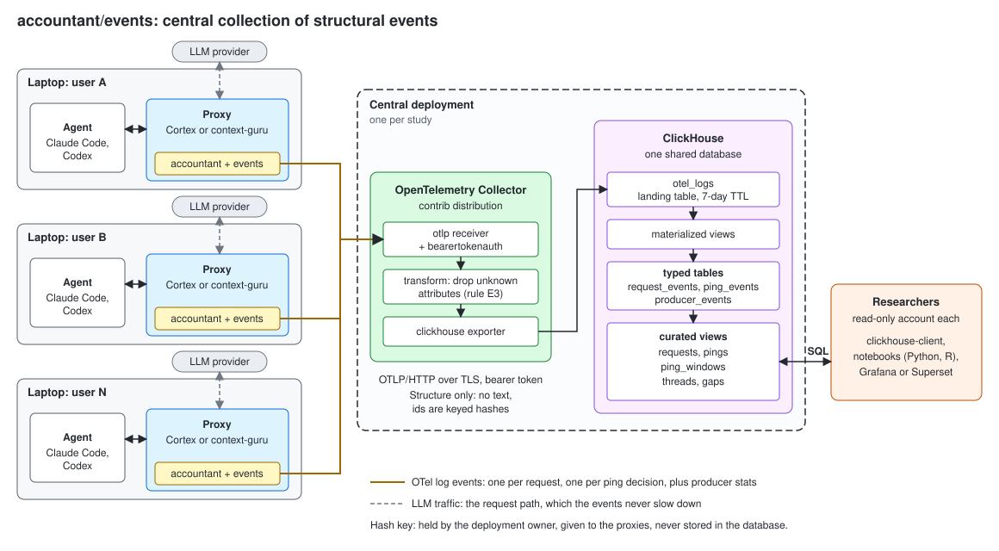

# The events module: one structural record for each request and each ping

Status: design, not implemented. Epic: [rossoctl/accountant#85](https://github.com/rossoctl/accountant/issues/85).

`accountant/events` turns each request, each keep-alive ping decision and each client lifecycle signal that a
proxy handles into one **structural event**. Each proxy exports its events to **one central collector**. Researchers read the
collected events to study usage patterns, find bottlenecks, and compare caching strategies.

It is a nested Go module, like [`metrics`](../metrics/metrics.md). The root module keeps importing only the standard
library (R3). The module imports OpenTelemetry **API** packages only (§3), never the SDK. The SDK, the exporter and the
collector address belong to the host.



Each user's laptop runs a proxy. The proxy forwards LLM traffic as usual and, after each response, emits one
structural event. All proxies export to one OpenTelemetry Collector, which writes one ClickHouse database.
Researchers query that database with SQL (§9).

## 1. Intent

- Researchers need per-request facts from real traffic: sizes, timings, token tiers, cache behaviour, and
  what context-guru and the keeper did. Counters (`metrics`) cannot answer questions about order, gaps or
  one thread's history. Events can.
- Two hosts produce the same kind of traffic: Cortex and the context-guru proxy. One schema, built in one
  module, keeps their events comparable.
- The data leaves the user's machine. So the events carry **structure only**: no text, no names that a
  user wrote, and no identifier in clear.

## 2. Goals, non-goals, anti-goals

Goals:

1. One event for each inference request, one for each keep-alive ping decision (sent, refused, failed), and one
   for each client lifecycle signal.
2. The same schema from Cortex and from the context-guru proxy.
3. A researcher can find every gap in the data: a lost event, a restart, a dropped batch.
4. A researcher can rebuild one thread's sequence of requests and pings, in order, with the idle gaps.
5. A researcher can join one user's sessions across machines, without knowing who the user is.

Non-goals:

1. Live dashboards and alerts. `metrics` does that.
2. Billing or the cost ledger. The event carries tokens; money is optional and never authoritative.
3. Replay of a request. No body is kept, so no request can be replayed.
4. A durable spool on disk. Version 1 buffers in memory only (§9). The schema does not depend on it.

Anti-goals (a failure even if the code works):

1. **Any text from a request or a response reaches the collector.** This includes tool names, file paths,
   model output, error messages from the provider, and host names of private gateways.
2. **A plain hash of an identifier.** The set of user ids is small, so a plain hash can be reversed by trying
   every candidate. All identifiers use a keyed hash (§5).
3. **The event changes the request path.** The emit must not block, must not do I/O, and must not fail a
   request.
4. **Silent gaps.** A drop that the data cannot show makes every rate wrong.

## 3. Constraints

- The host calls an **emit method** (`Request`, `Ping`, `Signal`, §8) after the response is finished, never on
  the request path, like `metrics.Observe`.
- An emit method returns fast: no network call, and no lock held across I/O. The OpenTelemetry batch
  processor does the export.
- The module does not keep slices of the `Result` or of the `Body` after an emit method returns.
- The module imports `accountant` and three OpenTelemetry API packages: `go.opentelemetry.io/otel/log` (the
  logger), `go.opentelemetry.io/otel/attribute` (`ResourceAttributes`) and `go.opentelemetry.io/otel`
  (`ErrorHandler`). Nothing else outside the standard library, and never the SDK.
- Every timing that measures a duration comes from one process's monotonic clock. Wall-clock timestamps
  are for order and for joins only. Laptop clocks drift; durations across hosts are never computed.
- Off by default. The host turns it on with an endpoint and a hash key.

## 4. Approaches

| Approach | What it is | Trade-off |
|---|---|---|
| **A. OTLP log events (chosen)** | This module emits OTel log records. Each proxy exports OTLP. One central OpenTelemetry Collector writes columnar storage. | No collector code to write. Buffering is in memory only, so a long offline laptop loses events. `producer.seq` makes the loss visible. |
| B. Own exporter and own collector | HTTP/JSON batches, a disk spool, an ingest service. | Full control of buffering and exact drop counts. A service to write, run and secure, which repeats what the OTel Collector does. |
| C. Export Cortex session events | No new module. | The context-guru proxy gets nothing. The schema follows Cortex internals. |

Chosen: A. It needs no collector code, and both hosts already use OpenTelemetry. A disk spool can come later
without a schema change, because the gap fields (§6.1) do not depend on the transport.

## 5. Identifiers and the keyed hash

All identifiers that the user or the client chose go through one function:

```
id_hash(kind, value) = hex(HMAC-SHA256(key, kind + "\x00" + value)[:16])
```

- `kind` names what the value is: `user`, `session`, `thread`, `request`, `provider_request`, `tenant`,
  `project`, `workload`, `host`, `tool`, `prefix`, `change`, `config`, or `x.<key>` for a hashed extra. So
  equal values of different kinds do not collide.
- `key` is one secret for each **deployment** (one research study). Every proxy in the deployment has the same
  key, so one user hashes to the same value on every machine. Researchers never get the key.
- `hash_key_id` names the key on every event. A key rotation starts a new `hash_key_id`; hashes do not join across
  key ids. That is intended.
- The module computes the hash (`events.NewHasher(key, hashKeyID)`). Hosts never hash by themselves, so both hosts
  give the same value for the same input.

Where the user id comes from:

- Claude Code sends `metadata.user_id` in the request body. The host takes the account part of it.
- Other clients: the host may use the credential's stable id (an API key id, never the key). If there is none,
  `user_hash` is absent.

Thread ids: the accountant's `Thread.ID` and `Thread.Parent` may be host-made (`main`, `sub:3`) or may come
from the client. The module hashes both, except the literal `main`, which it keeps so a researcher can find
the primary thread. A host-made id is not stable across a restart: `sub:3` before and after a restart can be
two different threads. A researcher joins one conversation across a restart on `session_hash`, not on
`thread.id`.

## 6. The event schema

Each event is one OTel log record:

- `EventName` is `accountant.request`, `accountant.ping`, `accountant.signal` or `accountant.stats`.
- `Timestamp` is the wall time the event describes:
  - request: the receive time, at `t0` (§6.4);
  - ping: the decision time, which is also the send time of a sent ping;
  - signal: the time the host accepted the signal;
  - stats: the time of the snapshot.

  Storage names this column `at` in every typed table (§9.1).
- `ObservedTimestamp` is when the emit method ran.
- The body is empty. All fields are log attributes. Nested groups are OTel map values. Lists are OTel slice
  values.

Notation: `?` marks a field that may be absent. Absent means **unknown**, never zero. A zero is a real zero.

A field or a group can also be absent because it **does not apply**: for example `body.out.*` on a request
that a plugin denied, or `cg.sweep.*` when the sweep did not run. Such a field says so in its Meaning, and
names the field that tells "does not apply" from "unknown". The rule for storage is in §9.1.
Source: **A** the accountant (`Body`, `Breakpoint`, `Usage`, `Result`), **H** the host, **M** this module.

Every field has one prefix, and one prefix is one concern:

| Prefix | Concern | Section |
|---|---|---|
| none, `producer.` | Envelope | §6.1 |
| none, `thread.` | Identity | §6.2 |
| `client.`, `route.`, `model.`, `params.` | Client and route | §6.3 |
| `time.` | Timing | §6.4 |
| `body.in.`, `body.out.` | Request structure | §6.5 |
| `trigger.` | Why the client sent the request | §6.5.1 |
| `tools.` | Tool declarations | §6.5.2 |
| `resp.` | Response | §6.6 |
| `limit.` | Rate-limit, subscription and budget headroom | §6.6.1 |
| `tokens.`, `cost.` | Billed tokens and cost | §6.7 |
| `cache.`, `acct.` | Cache state and the accountant result | §6.8, §6.9 |
| `cg.` | The context-guru engine, its components, the keeper and the keep-alive ping | §6.9.1–§6.10 |
| `plugins` | The Cortex plugins | §6.9.4 |
| `stats.`, `extras` | Producer stats | §6.11 |
| `x.` | Host extras | §6.12 |
| `signal.` | Client lifecycle signal | §6.13 |

A whole group is absent when it does not apply: for example `cg.sweep` when the sweep did not run, or
`plugins` on a context-guru proxy event. §6.14 lists the fields that are **not** recorded because another
field already gives them.

### 6.1 Envelope (every event)

The **producer** is the host process that emits the events: one context-guru proxy, or one Cortex, on one
machine. The envelope says which producer emitted a record, and where the record is in that producer's
sequence.

Fields on every record:

| Field | Type | Source | Meaning |
|---|---|---|---|
| `schema_version` | int | M | `1`. A new field does not change it; a changed meaning does. |
| `event_id` | string | M | Random 128-bit id, hex. Unique for each record. A researcher uses it to remove a record that the exporter sent twice. |
| `hash_key_id` | string | H | The name of the HMAC key that made the hashes of this record (§5). Not unique: every record of a deployment has the same `hash_key_id` until the key is rotated. Two hashes join only if their `hash_key_id` is equal. `NewHasher` accepts only `^[a-z0-9][a-z0-9_.-]{0,31}$`. |
| `producer.seq` | int | M | Starts at 1 for each `producer.run_id`, plus 1 for each event the module receives, all event kinds, before validation (E7). A gap in `seq` is a lost or refused event. |
| `cg.engine.config_hash` | string? | H→M | `id_hash("config", canonical JSON of the engine config)`. Same config, same value. On each record, because a hosted proxy can change a tenant's config inside one run: the host gives the config JSON in `HostFacts` and `PingHostFacts` (§8). Absent on a host with no engine, and on stats and signal records. |

Fields that do not change inside one run are **OTel resource attributes**, not record attributes. The host
puts them on the `LoggerProvider`'s resource (§9), so they are sent once for each export batch. The collector
stores them in the `ResourceAttributes` column, and the typed tables copy them to columns (§9.1):

| Resource attribute | Column | Source | Meaning |
|---|---|---|---|
| `service.instance.id` | `producer_id` | H | Random id of one install, kept on disk by the host. Not derived from the host name. `NewProducer` accepts only 32 hex characters. |
| `producer.run_id` | `producer_run_id` | M | Random id of one start of the host process. A restart gives a new `run_id`, and `producer.seq` starts again at 1. |
| `service.name` | `producer_kind` | H | `cortex` \| `context-guru-proxy`. |
| `service.version` | `producer_version` | H | Host version. `NewProducer` accepts only a version string (the `client.version` format, §6.3). |
| `producer.accountant.version` | `producer_accountant_version` | M | Accountant module version, read from `runtime/debug.ReadBuildInfo`. |
| `cg.engine.version` | `cg_engine_version` | H | context-guru engine version. Absent when the host has no engine. |

The OTel names `service.*` are used where OTel defines one, so other OTel tools read them too.

### 6.2 Identity (request, ping and signal)

| Field | Type | Source | Meaning |
|---|---|---|---|
| `user_hash` | string? | H→M | §5. Cortex: `EventIdentity.Subject`. |
| `session_hash` | string | A→M | `RequestMeta.Session`. |
| `request_hash` | string | A→M | `id_hash("request", RequestMeta.RequestID)`. Hashed even though the proxy makes it, so a host that fills it from a header cannot leak that header. |
| `provider_request_hash` | string? | H→M | Hash of the provider's request id header. Lets a provider-side study join, with the key. |
| `tenant_hash` | string? | H→M | Hash of the account the host keys its state, caps and maps on. Hosted deployments only. `user_hash` is the person; `tenant_hash` is the account. |
| `project_hash` | string? | H→M | Hash of the project id. Tool filtering and tool deferral key their history on it. |
| `workload_hash` | string? | H→M | Cortex only: hash of `EventIdentity.AgentID`, else of the peer's SPIFFE id (`EventTLS.PeerSPIFFEID`). |
| `thread.id` | string | A→M | `main`, or the hash of `Thread.ID`. |
| `thread.parent` | string? | A→M | `main`, or the hash of `Thread.Parent`, as for `thread.id`; absent when the thread has no parent. So a subagent's `thread.parent` equals its parent's `thread.id`. |
| `thread.turn` | int | H | Index of this request in its thread, from 1. It counts within one `producer.run_id` only, and starts again after a restart. |

Every identity field is a keyed hash (§5), so its name ends in `_hash`. `thread.id` is a hash too, except the
literal `main`.

`request_hash` and `provider_request_hash` name the same request, from two sides:

- `request_hash` is the **host's** id of the request (`RequestMeta.RequestID`). The host makes it; every
  request has one. It joins the records of this schema, for example a request to its `failed_checks`.
- `provider_request_hash` is the **provider's** id of the request, from its response header (Anthropic
  `request-id`, OpenAI `x-request-id`). It is absent when the request did not reach the provider. The key
  holder can compute it from a provider log or a support ticket, and so find the request in the data.

A ping carries the identity fields and `thread.*` without `request_hash` and `thread.turn`. A sent ping has its
own `provider_request_hash`; a refused ping has none. A signal carries the identity fields without
`request_hash`, and no `thread.*` (§6.13).

### 6.3 Client and route (request)

| Field | Type | Source | Meaning |
|---|---|---|---|
| `client.name` | enum | H | `claude-code` \| `codex` \| `other`. Parsed from `User-Agent`. Cortex: `EventClient.Name`. |
| `client.version` | string? | H→M | Version of a known agent only. The module keeps it only if it matches `^\d+\.\d+\.\d+([-.][0-9A-Za-z.]{1,16})?$`; otherwise the field is absent. Absent for `other`. |
| `route.provider` | enum | H | `anthropic` \| `openai` \| `bedrock` \| `vertex` \| `gateway` \| `other`. |
| `route.dialect` | enum | H | `messages` \| `chat` \| `responses` \| `completions` \| `other`. |
| `route.host_hash` | string | H→M | Hash of the upstream host. A private gateway name never leaves in clear. |
| `route.billing_mode` | enum | A | `api` \| `subscription` \| `unknown`. |
| `route.redirected` | bool? | H | A plugin sent the request to another host than the client asked for (Cortex `RequestedHost`). The requested host is not sent. |
| `model.requested` | string | H | Model the client asked for. |
| `model.sent` | string | A | `RequestMeta.Model`. |
| `model.key` | string? | A | `RequestMeta.ModelKey`: the model apart from the spelling of its id. For example `claude-sonnet-4-5`, `claude-sonnet-4-5-20250929` and a gateway's `aws/…` id of the same model can share one key. The accountant compares the key, not the id, when it decides whether the model changed. Absent when the host gives none. |
| `model.context_window` | int? | H | The model's context window in force for this request, in tokens (for example 200,000, or 1,000,000 with the 1M option). Not the size of this request; that is `body.out.*.S.tokens`. Every window share needs it. |
| `model.context_window_exact` | bool? | H | The window comes from the model catalogue, not from a default guess. |
| `params.stream` | bool | H | |
| `params.max_tokens` | int? | H | |
| `params.effort` | enum? | A | `RequestMeta.Params["effort"]`: `low` \| `medium` \| `high` \| `xhigh` \| `max` \| `other`. |
| `params.thinking_mode` | enum? | H | `enabled` \| `adaptive` \| `disabled` \| `between_tools` \| `other`. |
| `params.thinking_budget` | int? | H | |
| `params.tool_choice` | enum? | H | `auto` \| `any` \| `tool` \| `none` \| `other`. The tool name is not sent. |
| `params.temperature` | float? | H | |
| `params.top_p` | float? | H | |
| `params.retry` | int? | H | Client retry count (`x-stainless-retry-count`), when the client sends it. |

Model ids are provider catalogue names, not user text. The module accepts only strings that match
`^[A-Za-z0-9._:/@-]{1,96}$`; any other value becomes `other`.

### 6.4 Timing (request)

All `_ms` fields are durations on the proxy's monotonic clock, from `t0` = the proxy read the first byte of
the request. The wall time at `t0` is the record `Timestamp` (`at` in storage); it is not sent a second time.
The wall time of the forward is `at` + `body_read_ms` + `pipeline_ms`.

| Field | Type | Source | Meaning |
|---|---|---|---|
| `time.tz_offset_min` | int? | H | The user's offset from UTC, in minutes. Gives the local hour and the day of the week. |
| `time.body_read_ms` | int | H | `t0` to the last request byte. |
| `time.pipeline_ms` | int? | H | Last request byte to the forward. Includes compaction. Does not apply when the request was not forwarded (`resp.error_kind` `denied`). |
| `time.cg_engine_ms` | int? | H | context-guru engine time inside `pipeline_ms`. |
| `time.connect_ms` | int? | H | Dial and TLS to upstream; absent when a pooled connection was used. |
| `time.ttfb_ms` | int? | H | Forward to the first response byte. |
| `time.first_token_ms` | int? | H | Forward to the first content delta (stream only). |
| `time.response_end_ms` | int? | H | Forward to the last response byte. Does not apply when the request was not forwarded. |
| `time.total_ms` | int | H | `t0` to the last byte sent to the client. Cortex: `SessionEvent.Duration`. |

The idle gaps are not sent. The `requests` view computes them from the previous request of the same
thread: the same `(producer_id, producer_run_id, session_hash, thread_id)` (§9.1). `thread_id` alone is not
enough, because `main` is the id of the main thread in every session.

| View column | Computed as |
|---|---|
| `gap_prev_start_ms` | This `at` minus the previous request's `at`. The accountant measures the cache gap the same way. |
| `gap_prev_end_ms` | This `at` minus (the previous request's `at` + `time.total_ms`). The user's think time plus tool time. |
| `gap_last_ping_ms` | This `at` minus the `at` of the last sent ping of the thread in the gap. |

These are wall-clock differences on one machine. A clock step between two rows makes one gap wrong. The view
sets a gap to NULL when the run changed, or when the `gaps` view has a missing `producer.seq` between the two
rows: the lost record may be a request of this thread. A missing seq of another thread also gives NULL, so
the rule loses some good gaps, but never keeps a wrong one.

### 6.5 Request structure (request)

Two copies: `body.in.*` is the body the client sent; `body.out.*` is the body that went upstream. Both come
from the accountant `Body` values the host already builds with `NewBody`. `body.out.*` does not apply when
the request was not forwarded (`resp.error_kind` `denied`).

For each section `S` in `tools`, `system`, `messages`:

| Field | Type | Source | Meaning |
|---|---|---|---|
| `<copy>.S.count` | int | A | Positions in the section: the next section's `Body.Start` offset (or `len(Body.Pos)`) minus this one's. |
| `<copy>.S.bytes` | int | A | Sum of `PosHash.Bytes`. |
| `<copy>.S.media_bytes` | int | A | Sum of `PosHash.Media`. |
| `<copy>.S.tokens` | int? | H | Tokens of the section. Absent when the host did not count them. |
| `<copy>.S.max_bytes` | int | A | Largest position in the section. |

One field for each copy, not for each section:

| Field | Type | Source | Meaning |
|---|---|---|---|
| `<copy>.tokens_basis` | enum? | H | How `S.tokens` was counted: `provider` (the provider's count call, exact) \| `estimate` (a local estimate) \| `other`. |

A **position** is one entry that the host gives to `NewBody(tools, system, messages)`: one tool declaration,
one system block, or one message. `Body.Start` gives the first position of each section.

Example: the host calls `NewBody` with 3 tool declarations, 2 system blocks and 5 messages. Then
`Body.Start = [0, 3, 5]` and `len(Body.Pos) = 10`, so:

```
body.in.tools.count    = 3 - 0  = 3
body.in.system.count   = 5 - 3  = 2
body.in.messages.count = 10 - 5 = 5
```

If context-guru removed one tool and two messages, `body.out.tools.count = 2` and `body.out.messages.count = 3`.

`S.tokens` is a count of tokens, not a byte figure. `tokens_basis` says if the provider counted them
(exact) or the host estimated them. A researcher who needs exact figures keeps only `provider`.

Message shape, counts only (`body.in.*` and `body.out.*`), source H:

| Field | Meaning |
|---|---|
| `<copy>.msg.user`, `.assistant` | Messages by role. |
| `<copy>.blk.text`, `.tool_use`, `.tool_result`, `.thinking` | Content blocks by type. |
| `<copy>.blk.image.base64`, `.url`, `.file` | Image blocks by source. A url or file source has no bytes in the body. |
| `<copy>.blk.document.base64`, `.url`, `.file`, `.text` | Document blocks by source. |
| `<copy>.tool_result.bytes`, `.tool_result.max_bytes` | Size of tool results, total and largest. |
| `<copy>.opaque_bytes` | Bytes the provider bills but the client cannot read: thinking signatures, `redacted_thinking.data`, OpenAI `encrypted_content`, Gemini `thoughtSignature`. They change the ratio of tokens to bytes. |

The role sequence is **not** recorded.

Example. The client sends these 5 messages:

| # | Role | Content blocks |
|---|---|---|
| 1 | user | 1 text ("fix the bug"), 1 image (base64, 80,000 bytes) |
| 2 | assistant | 1 thinking (with a signature of 1,200 bytes), 1 text, 2 tool_use (`Read`, `Bash`) |
| 3 | user | 2 tool_result: `Read` (4,800 bytes), `Bash` (600 bytes) |
| 4 | assistant | 1 text |
| 5 | user | 1 text |

The host counts them like this. Only the numbers are sent:

```
body.in.msg.user              = 3      messages 1, 3, 5
body.in.msg.assistant         = 2      messages 2, 4
body.in.blk.text              = 4      one each in messages 1, 2, 4, 5
body.in.blk.thinking          = 1      message 2
body.in.blk.tool_use          = 2      message 2
body.in.blk.tool_result       = 2      message 3
body.in.blk.image.base64      = 1      message 1
body.in.tool_result.bytes     = 5400   4,800 + 600
body.in.tool_result.max_bytes = 4800   the Read result
body.in.opaque_bytes          = 1200   the thinking signature
body.in.messages.media_bytes  = 80000  the image (§6.5, from NewBody)
```

So a researcher sees that the conversation has one tool loop, one image and one thinking block. The text and
the file contents are not sent. A tool name is sent only if it is on the built-in allowlist (§6.5.2).

Cache structure:

| Field | Type | Source | Meaning |
|---|---|---|---|
| `<copy>.breakpoints` | list of `{section, index, ttl}` | A | `Breakpoint` values. Positions only. |
| `<copy>.prefix_at_breakpoints` | list of string | A→M | `id_hash("prefix", PosHash.Hash)` at each breakpoint. Equal values mean an equal prefix, across requests and users of the deployment. |
| `<copy>.common_prefix` | `{section, index, bytes}`? | M | Longest prefix shared with the previous forwarded body of the thread, from the cumulative hashes. Absent on the first request. |

### 6.5.1 Trigger (request)

What made the client send this request. The host derives it from the structure of the client body, and from
the previous request of the thread. It reads no text.

| Field | Type | Source | Meaning |
|---|---|---|---|
| `trigger.kind` | enum | H | See the table below. |
| `trigger.basis` | enum | H | `structure` (from the body shape), `header` (the client said so), `heuristic` (a size or timing rule), `other`. Researchers can filter out `heuristic`. |
| `trigger.tool_results_by` | map tool key → int | H→M | `tool_result` blocks in the last user message, by tool (tool key: §6.5.2). The total is the sum of the map. Empty when the last user message has no `tool_result`. |
| `trigger.tool_errors` | int? | H | Of those, how many have `is_error` set. |
| `trigger.tool_result_bytes` | int? | H | Bytes of those blocks. |
| `trigger.parallel` | bool? | H | The previous response asked for more than one tool call, and this request returns them together. |

`trigger.kind` values:

| Value | Rule (the host checks in this order; the first match wins) | Basis |
|---|---|---|
| `retry` | The client body hash equals the previous request's in the thread, or the client sent a retry count above 0. | `structure` or `header` |
| `compaction` | The host set `RequestMeta.Compaction` on this request. | as the host knows it |
| `subagent_start` | First request of a thread that has a `Thread.Parent`. | `structure` |
| `side_call` | A request outside the main loop: no tools and at most 2 messages in a thread that had tools, such as a title or summary call. | `heuristic` |
| `background` | The last user message reports that a background task finished. | `structure` |
| `teammate` | The last user message carries a message from another agent of the same team. | `structure` |
| `tool_result` | The last message is a user message whose blocks are all `tool_result`. | `structure` |
| `user_prompt` | The last message is a user message with at least one text or media block and no `tool_result`. | `structure` |
| `mixed` | The last user message has both `tool_result` and text blocks (a user interjection during a tool loop). | `structure` |
| `continuation` | The last message is an assistant message (prefill), or the previous response stopped with `pause_turn` or `max_tokens`. | `structure` |
| `other` | None of the above. | |

Example. The previous response asked for two tools, `Read` and `Bash`. The client runs both and sends the
results in one user message. The `Bash` result has `is_error` set:

```
trigger.kind              = tool_result     the last user message holds only tool_result blocks
trigger.basis             = structure
trigger.tool_results_by   = {Read: 1, Bash: 1}   2 results
trigger.tool_errors       = 1
trigger.tool_result_bytes = 5400
trigger.parallel          = true            two tool calls, returned together
```

With the gap since the previous response (`gap_prev_end_ms`, §6.4), the trigger separates different waits:

- `tool_result`: the gap is mostly tool execution time.
- `user_prompt`: the gap is the user's think time.
- `background`, `teammate`: the gap is the time of work that ran outside this thread.

Keep-alive pings are not requests and have their own event (§6.10). A ping never has a `trigger`.

### 6.5.2 Tool declarations (request)

`tools.decl` is a list, one map per tool declaration in the **client** body, in order. The forwarded body
has no list of its own: `state` says what happened to each declaration on the way upstream. So one list shows
both bodies, and `body.out.tools.count` equals the entries whose `state` is `sent`.

| Field | Type | Source | Meaning |
|---|---|---|---|
| `id` | string | H→M | `id_hash("tool", name + "\x00" + canonical JSON of the input schema)`. The same declaration has the same id across requests and users. |
| `name` | enum? | H→M | The tool name, only if it is in the client's built-in allowlist (`Names.BuiltinTools`: `Bash`, `Read`, `Grep`, …). Absent for every other tool. |
| `kind` | enum | H | `builtin` \| `mcp` \| `custom` \| `other`. |
| `bytes` | int | H | Size of the declaration. |
| `tokens` | int? | H | Measured tokens of the declaration. |
| `state` | enum | H | `sent` (in the forwarded body) \| `deferred` (held back for a later load) \| `removed` (filtered out). |

`tools.decl` is a list, so storage cannot tell "no tools" from "unknown" (§9.1). `tools.decl_known` (bool, H)
is true when the host parsed the declarations; an empty list with `tools.decl_known` true means no tools.

A **tool key** is the allowlisted `name` when there is one, else the `id`. `trigger.tool_results_by` and
`resp.tool_use_by` use tool keys, so they join to `tools.decl`.

The name of an MCP or custom tool is chosen by a user or a server, so it never leaves in clear (anti-goal 1).

### 6.6 Response (request)

| Field | Type | Source | Meaning |
|---|---|---|---|
| `resp.status` | int | H | Status sent to the client. |
| `resp.error_kind` | enum? | H | `upstream_timeout` \| `upstream_refused` \| `upstream_dns` \| `upstream_tls` \| `upstream_error` \| `client_canceled` \| `proxy_error` \| `rate_limited` \| `overloaded` \| `denied` \| `other`. `denied`: a gate refused the request, and it did not go upstream (Cortex `Phase=denied`); the gate is the `plugins` entry with `action` `deny` (§6.9.4). Never the error text. |
| `resp.stop_reason` | enum? | H | `end_turn` \| `tool_use` \| `max_tokens` \| `stop_sequence` \| `pause_turn` \| `refusal` \| `other`. |
| `resp.bytes` | int? | H | Response body bytes as received from upstream. Does not apply when the request was not forwarded. |
| `resp.blk.text`, `.thinking` | int? | H | Output blocks by type. |
| `resp.tool_use_by` | map tool key → int | H→M | The tool calls of the response, by tool (§6.5.2). The number of tool calls is the sum of the map. The tool the agent waits for is here. |
| `resp.sse_buffered` | bool? | H | The host buffered the stream before it sent it to the client. This adds latency. |

### 6.6.1 Limits (request)

Headroom at the response. The host reads it from the provider's response headers, or from its own budget:

- `limit.api.*`: the API rate-limit headers, `anthropic-ratelimit-{input-tokens,requests}-{remaining,limit}`
  (and the provider's equivalents). `left_pct` is `remaining / limit`.
- `limit.sub.*`: the subscription headers, `anthropic-ratelimit-unified-{5h,7d}-{utilization,reset,status}`.
  They are present only on a subscription login.
- `limit.budget.*`: the host's own daily budget, when it has one.

| Field | Type | Source | Meaning |
|---|---|---|---|
| `limit.api.tokens_left_pct` | int? | H | Remaining input-token limit, percent. |
| `limit.api.requests_left_pct` | int? | H | The same for requests. |
| `limit.sub.5h.util_pct` | int? | H | Subscription 5-hour window: the used share, percent. The header gives a 0..1 fraction. |
| `limit.sub.5h.reset_at` | timestamp? | H | When the 5-hour window resets. The header gives a Unix time. |
| `limit.sub.5h.status` | enum? | H | `allowed` \| `allowed_warning` \| `rejected` \| `other`. |
| `limit.sub.7d.util_pct`, `.reset_at`, `.status` | | H | The same for the 7-day window. |
| `limit.budget.used_pct` | int? | H | Share of the host's daily budget used. Cortex: `cost` event, `DailyTotalUSD / DailyMaxUSD`. |

On a subscription, a saving matters most near the plan limit. So `limit.sub.*` sets the value of every lever
there.

### 6.7 Tokens and cost (request)

`tokens.*` are token counts that the provider reported in its usage. They are absent when the response has
no usage (an upstream error, a denied request); a 0 is a real 0. `cost.*` are money, computed by the host.

| Field | Type | Source | Meaning |
|---|---|---|---|
| `tokens.input` | int? | A | `Usage.Input` (uncached). |
| `tokens.cache_read` | int? | A | `Usage.CacheRead`. |
| `tokens.cache_write_5m` | int? | A | `Usage.CacheWrite - Usage.CacheWrite1h`. |
| `tokens.cache_write_1h` | int? | A | `Usage.CacheWrite1h`. |
| `tokens.output` | int? | H | Output tokens, including reasoning. |
| `tokens.reasoning` | int? | H | Reasoning part of output, when the provider says. |
| `cost.amount` | float? | H | Only if the host has a `Pricer` and `route.billing_mode` is `api`. In the unit `cost.currency`. Never authoritative. |
| `cost.estimated` | bool? | H | The `Pricer` said estimated. |
| `cost.source` | enum? | H | `gateway` (the gateway's own figure) \| `modelled` (priced from tokens). Cortex: `cost.Source`. |
| `cost.provenance` | enum? | H | `authoritative` \| `configured` \| `discovered` \| `bundled`. Cortex: `cost.Provenance`. |
| `cost.currency` | enum? | H | `usd` \| `credits` \| `other`. The unit of `cost.amount` and of the booked extras. Present whenever the record has a money field; absent only when it has none. |
| `cost.refused` | enum? | H | The host refused a cost figure: `cost_implausible` \| `usage_implausible` \| `incomplete` \| `other`. Cortex: `cost.RejectedReason`, `cost.Incomplete`. |

### 6.8 Cache state and accountant result (request)

`cache.*` (except `cache.host_*`), `acct.*` and `acct.ops` come from the `Result` of `Compute`. A host does not
call `Compute` for a request that failed before a response, or that a plugin denied (cortex-wiring.md §W5.3, "A failed request").
On such a request these fields do not apply, and `acct.computed` is false. Storage keeps them `Nullable` for
this reason (§9.1).

| Field | Type | Source | Meaning |
|---|---|---|---|
| `acct.computed` | bool | M | The host gave a `Result` (`Request.Result` is not nil). When false, every field below that comes from `Result` does not apply. `cache.host_*`, `acct.estimate_held` (H) and the `EntryFacts` fields (`cache.entry_ttl_s`, `cache.lifetime`, `cache.min_cacheable`, `cache.shared_warm`) still apply when the host has them. |

| Field | Type | Source | Meaning |
|---|---|---|---|
| `cache.phase` | enum | A | `Result.Phase`: `hot` \| `cold` \| `unknown`. |
| `cache.host_phase` | enum? | H | The host's own cold decision: `hot` \| `cold` \| `unknown`. A difference from `cache.phase` shows that the host's cold clock and the accountant disagree. |
| `cache.host_miss_reason` | enum? | H | The host's label for a cache miss. Kept next to `cache.effects`, so a wrong label can be found. |
| `cache.entry_ttl_s` | int? | A | `EntryFacts.TTL` in seconds. |
| `cache.lifetime` | enum | A | `exact` \| `minimum` \| `unknown`. |
| `cache.min_cacheable` | int? | A | `EntryFacts.MinCacheable`. |
| `cache.boundary` | `{section, index}`? | A | `Result.Boundary`. |
| `cache.shared_warm` | `{section, index}`? | A | `EntryFacts.SharedWarm`. |
| `cache.effects` | list | A | One map per `CacheEffect`: `kind`, `cause?`, `ttl?`, `in_baseline`, `estimated`, `from?`, `to?`, `saved` and `caused` as tier maps, `change` (§6.9). |
| `acct.recomputed` | bool | A | `Result.Recomputed`. |
| `acct.failed_checks` | list | A | One map per `CheckFailure` (§6.8.1). |
| `acct.unpriced` | list of string | A | `Unpriced.Reason` values. |
| `acct.compaction` | enum? | A | `manual` \| `auto` \| `unknown`. |
| `acct.interaction` | tier map | A | `Result.Interaction`: on a rescued request, the tokens the client body would have billed cold. |
| `acct.interaction_caused` | tier map | A | `Result.InteractionCaused`: what the operations already book for those tokens. Price `interaction` minus `interaction_caused`, as the host does (design.md §6.2). |
| `acct.storage_tokens` | int? | A | `Result.StorageTokens`. |
| `acct.active_ops` | int? | A | Active in-place operations in the thread state. A count that keeps rising shows a stale operation before the money does. Needs an accountant change (below). |
| `acct.oldest_op_turns` | int? | A | Requests of the thread since the oldest active operation was first applied. Needs an accountant change (below). |
| `acct.estimate_held` | bool? | H | The host held a price estimate instead of the measured figure. |

A tier map is `{input, cache_write_5m, cache_write_1h, cache_read}`, the `TierTokens` fields.

`acct.active_ops` and `acct.oldest_op_turns` need a change in the accountant. Today the active operations
are in `ThreadState.Active`, which is not public, and no operation records when it was first applied.
`Result` gets two fields: the count of active operations, and the request count since the oldest one was
first applied. Until then, the module leaves both fields absent.

### 6.8.1 Failed checks

The accountant runs consistency checks on each request (design.md §6.5). Each check compares what the
operations claim with what the bodies or the bill show. `acct.failed_checks` lists only the checks that
**failed**, one map for each `CheckFailure`, with the numbers behind it. An empty list means that every check
passed. Numbers only; `CheckFailure.Detail` is not sent.

| Field | Type | Meaning |
|---|---|---|
| `name` | enum | `CheckFailure.Check`: one of the accountant's `Check*` constants, else `other`. Today: `sum` \| `unique_change` \| `spans` \| `conservation` \| `shared_warm` \| `bad_usage` \| `ratio_range` \| `media_unseen` \| `breakpoints` \| `media_tokens` \| `opaque_tokens` \| `size_tokens` \| `size_range`. A module test compares this list with the constants, so a new check cannot become `other` unseen. |
| `fatal` | bool | `CheckFailure.Fatal()`. |
| `operator` | enum? | `CheckFailure.Operator`, from the operator allowlist (§6.9), else `other`. Absent when the check is not about one operator (for example `sum`). |
| `section` | enum? | `tools` \| `system` \| `messages`. Set for `sum` and `shared_warm` only. |
| `index` | int? | The position, when the check is about one position (`shared_warm`). |
| `unit` | enum? | `bytes` \| `tokens`. The unit of `want` and `got`, and of `limit`. It depends only on `name`; the accountant gives it (`CheckFailure.Unit()`), so the module keeps no table of its own. Absent when the entry has no `want` and `got`. |
| `want`, `want_after` | int? | What the bodies or the bill show. `want_after` only for a check with a before and an after side. |
| `got`, `got_after` | int? | What the operations claim. `got_after` the same. |
| `limit`, `limit_after` | int? | `size_range` only: the size limit before (after), in `unit`. |
| `tokens`, `tokens_after` | int? | `size_tokens` only: the tokens before (after) of the span, or of the operation with no spans, that failed. Only the side that failed is set. |
| `bytes`, `bytes_after` | int? | `size_tokens` only: the bytes of the same side. |
| `ratio_min`, `ratio_max` | float? | `size_tokens` only: the bounds of the ratio (below). |

What the numbers are, for each check that has them:

| Check | `unit` | `want` (`want_after`) | `got` (`got_after`) | Other fields |
|---|---|---|---|---|
| `sum` | bytes | Bytes the bodies changed in `section` | Bytes the operations claim for `section` | `section` |
| `conservation` | tokens | The bill difference | Tokens the operations claim | |
| `spans` | bytes | Span bytes before (after) the change | The operation's bytes before (after) | |
| `size_range` | bytes | — | The bytes before (after) of the operation, or of its span, that is over the limit | `limit`, `limit_after`. A limit is a rule, not a claim, so it is not in `want`. |
| `size_tokens` | — | — | — | `tokens`, `tokens_after`, `bytes`, `bytes_after`, `ratio_min`, `ratio_max`. Two units and no difference, so the numbers are not in `want` and `got`. See below. |
| `media_tokens` | tokens | Tokens billed | The media price | |
| `opaque_tokens` | tokens | Tokens billed | The tokens counted for the opaque bytes | |

The other checks have no numbers, only `name`, `fatal` and the position fields. `shared_warm` has `section` and `index`.

The difference is `want - got`; it is not sent. It has a meaning for every entry that has `want` and `got`, because
the two have the same unit. An entry with `got` and no `want` (`size_range`) is left out of a difference.

A number field is absent when the check has no such number. 0 is a real value (`sum` can have `want` 0), so
the accountant must mark presence, and the module must not send 0 for an absent number.

Some numbers in `Detail` have no field. They are not sent, because no query of this section needs them:

- `media_tokens`: the media tokens after the cap.
- `opaque_tokens`: the opaque bytes that have a count, and all the opaque bytes.
- `size_tokens`: the numbers of the side that did not fail.
- `bad_usage`, `ratio_range`, `media_unseen`, `breakpoints` of the request: the usage, the breakpoint count and the
  forwarded bytes; `media_unseen` also the unseen media blocks.
- `bad_usage` of one spend operation: the call usage, output and cost.

If a query needs one of them, add a field here and in `CheckFailure` first.

A `size_tokens` entry has only the side that failed: `tokens` and `bytes` for before, `tokens_after` and
`bytes_after` for after. The other side passed, or had no count and was not checked. A side fails when tokens ÷ bytes
is above `ratio_max`, or tokens ÷ text bytes is below `ratio_min`. The text bytes are the bytes less the media and
opaque bytes; they are not sent, so a query must not repeat the rule from these numbers.

How to debug with it. Example (accountant#70): one entry is
`{name: sum, fatal: true, section: messages, unit: bytes, want: 12000, got: 13285}`. The
operations claim 1,285 bytes more than the bodies show in the messages section, so an operation is stale: it
claims a change that is no longer in the body.

1. Find which checks fail, and where:

   ```sql
   SELECT name, operator, section, count() AS failures, avg(want - got) AS avg_delta
   FROM failed_checks
   WHERE at >= now() - INTERVAL 1 DAY
   GROUP BY name, operator, section ORDER BY failures DESC;
   ```

2. If one check and section has a constant delta, one operation is the cause. `sum` has no `operator`, so
   read the `acct.ops` of the same request (the `ops` view). A stale operation is usually a re-applied one
   (`reapplied` true), which has no `at`. Match it by `change` to the earlier request of the thread that first
   reported it: there `at.section` and the sizes are set. If the delta
   grows over the turns of a thread, an operation was not retired. Read `acct.active_ops` and
   `acct.oldest_op_turns` on the same thread to confirm.
3. If `fatal` is true, the figures of that request are not measured. The `requests` view gives this as the
   column `reliable` (no fatal failed check), equal to `Result.Reliable()`. Leave those requests out of a
   saving study.

The module reads the numbers from the typed fields of `CheckFailure` (#90): `Section`, `Index`, `Want`, `WantAfter`,
`Got`, `GotAfter`, `Limit`, `LimitAfter`, `Tokens`, `TokensAfter`, `Bytes`, `BytesAfter`, `RatioMin` and `RatioMax`,
each nil when absent, and `unit` from `CheckFailure.Unit()`. It never parses `Detail`, a formatted string whose shape
differs for each check.

### 6.9 Operations (request)

`acct.ops` is a list, one map per `PricedOp` of `Result.Ops`: the operations of this request, then the active
operations that the accountant applied again.

| Field | Type | Source | Meaning |
|---|---|---|---|
| `kind` | enum | A | `rewrite` \| `spend` \| `setting` \| `other`. |
| `operator` | enum | A | Operator name. Accepted only from the host's allowlist (`WithNames`), else `other`. |
| `change` | string | A→M | `id_hash("change", ChangeID)`. The same change on later requests has the same value. |
| `reapplied` | bool | A→M | An active operation applied again (its `OpID` starts with `active:`), not one of this request. |
| `dry_run` | bool | A | |
| `saved`, `caused` | tier map | A | |
| `estimated` | bool | A | |
| `size_before`, `size_after` | `{bytes, tokens?, media_bytes}`? | A | From the input `Operation` with the same `ID` (`Request.Ops`). Absent when `reapplied`: a re-applied operation has no input in this request. |
| `marker_bytes` | int? | H | Bytes of the marker the operation left in the body. Gross minus `marker_bytes` is the net removal. |
| `at` | `{section, index}`? | A | First touched position, from the same `Operation`. Absent when `reapplied`. |
| `call` | map? | A, H | Spend only. See below. |

`call`, for a spend operation (a model call that context-guru made, such as a summary or a sweep question):

| Field | Type | Source | Meaning |
|---|---|---|---|
| `model`, `route.host_hash` | | A | `ModelCall.Model`, `ModelCall.Host`. As in §6.3. |
| `tokens` | tier map + `output` | A | `ModelCall.Usage`. As in §6.7. |
| `detached` | bool | A | `ModelCall.Detached`: the call ran after the response. |
| `component` | enum | H | The component that made the call (§6.9.2). |
| `purpose` | enum | H | `summary` \| `sweep_question` \| `extract` \| `other`. |
| `cold` | bool? | H | The cache was cold when the call was made. |
| `escalated` | bool? | H | The call went to a larger model after a first attempt. |
| `candidate_tokens` | int? | H | Tokens the call could remove. |
| `accepted` | bool? | H | The answer was used. |
| `rejection` | enum? | H | Why the answer was not used. From `Names.Enums["acct.ops.call.rejection"]` (§8). |
| `latency_ms` | int? | H | |

The host gives the H fields for each spend operation in `HostFacts.Calls`, keyed by the operation's `ID`.

Every model call costs money, so every call is a spend operation, also when its answer is not used.

### 6.9.1 Context-guru engine (request)

The host gives the context-guru summary, source H. The `cg.*` fields come from the engine, so a host that
runs the engine sends them. On a host without the engine, the whole `cg.*` group does not apply;
`cg_engine_version` (§6.1) is absent there. Storage keeps every `cg.*` column `Nullable` for this reason.

| Field | Type | Meaning |
|---|---|---|
| `cg.mode` | enum | `observe` \| `enforce`. |
| `cg.applied` | bool | The forwarded body is the compacted one. |
| `cg.fallback_reason` | enum? | Why the original body was forwarded in `enforce` mode: `bypassed` \| `below_threshold` \| `wire_order` \| `count_changed` \| `panic` \| `other`. Does not apply when `cg.applied` is true or `cg.mode` is `observe`. |
| `cg.cache_aware` | bool | The cache-aware pipeline ran. |
| `cg.preset` | enum | Engine preset: the list of preset names that the engine version exports, plus `custom` (no preset) and `other`. The host passes the list in `Names.Presets`. |
| `cg.tokens_before`, `cg.tokens_after` | int | Engine counts, whole request. |
| `cg.frozen_tokens` | int | Prefix left alone for cache safety. |
| `cg.prefix_rewritten` | bool? | A change landed inside the previous turn's cached prefix. Absent when unknown. |
| `cg.saved_gross`, `cg.saved_unique` | int | Engine tokens. |
| `cg.attempted_tokens` | int? | Tokens the engine tried to remove. |
| `cg.restored_tokens` | int? | Tokens it put back. |
| `cg.compaction_point` | int? | The token count at which the client compacts. The denominator of every window share. |
| `cg.compaction_point_source` | enum? | `measured` \| `assumed` \| `window_fallback` \| `other`. |
| `cg.components` | list | One map per engine component that ran (§6.9.2). |
| `cg.sweep.*` | | The sweep, below. Does not apply when the sweep is not in `cg.components`. |
| `cg.expand.*` | | Expand, below. Does not apply when no expand was possible. |
| `cg.defer.*` | | Tool deferral, below. Does not apply when deferral is not in `cg.components`. |
| `cg.split.*` | | The cache split, below. Does not apply when the split is not in `cg.components`. |
| `cg.summary.*` | | The summarizer, below. Does not apply when the summarizer is not in `cg.components`. |
| `cg.ka.*` | | The keeper's view (§6.9.3). |

Component groups:

| Field | Type | Meaning |
|---|---|---|
| `cg.sweep.applied_cold`, `.applied_warm` | int | Sweep rewrites on a cold and on a warm cache. |
| `cg.sweep.referenced_later` | int | Swept items that the agent referenced later. |
| `cg.sweep.false_ref`, `.false_ref_warm` | int | Swept items whose later reference was false. |
| `cg.sweep.reapplied` | int | Rewrites applied again in the same session. |
| `cg.sweep.warm_gate` | enum? | The gate that decided a warm rewrite. |
| `cg.sweep.warm_rewrite_tokens` | int? | |
| `cg.expand.calls`, `.tokens`, `.reverts` | int | Expand calls, the tokens they restored, and reverts. |
| `cg.expand.by_origin` | list | `{origin, calls, tokens, first}`: `origin` (enum) is the operator that made the marker, from the operator allowlist; `first` is a first expand of that marker. |
| `cg.defer.list_tokens` | int | Tokens of the list of deferred tools. |
| `cg.defer.loads`, `.wrong_guesses`, `.searches`, `.dropped_searches`, `.direct_calls`, `.retries_400` | int | |
| `cg.defer.client_search_disabled` | enum? | Why the client's own tool search is off. |
| `cg.defer.probe` | enum? | Outcome of the deferral probe. |
| `cg.split.stable_tokens` | int | Tokens in the stable part of the split. |
| `cg.split.tail_hash` | string | `id_hash("prefix", …)` of the cumulative hash at the end of the stable part. Equal values mean an equal stable part. |
| `cg.summary.gate_basis` | enum | `thread` \| `session`: what the summary gate read. |
| `cg.summary.gate_tokens` | int | The billed input the gate compared. |
| `cg.summary.reserve_written`, `.reserve_used` | int? | Tokens of the summary reserve. |
| `cg.summary.reserve_age_s` | int? | |
| `cg.summary.refresh` | enum? | `paid` \| `not_worth_it` \| `other`. |

### 6.9.2 Context-guru components (request)

`cg.components` is a list, one map per engine component that ran. `acct.ops` lists only priced operations.
This list also shows a component that skipped, was gated, reverted, or acted with no operation.

| Field | Type | Meaning |
|---|---|---|
| `name` | enum | From the host's allowlist (`WithNames`), else `other`. |
| `action` | enum | `acted` \| `skipped` \| `gated` \| `reverted` \| `error`. |
| `reason` | enum? | The skip, gate or error reason, from the component's declared enum. Never the error text. |
| `mutated` | bool | The component changed the body. |
| `first` | bool? | A fresh act, not a replay of an earlier one. |
| `saved_gross`, `saved_unique` | int? | Engine tokens. |
| `duration_ms` | int? | |
| `gates` | map enum → int | How many times each gate fired. |

### 6.9.3 The keeper's view (request)

`cg.ka.*` is the keeper's view after the response: why the agent waits, and the ping plan for the gap that
starts now. The ping events of that gap (§6.10) record what happened to the plan.

| Field | Type | Meaning |
|---|---|---|
| `cg.ka.wait_cause` | enum? | `own_tool` \| `background` \| `human` \| `teammate` \| `done` \| `none`. |
| `cg.ka.wait_timeout_ms` | int? | The timeout of the awaited tool, when known. |
| `cg.ka.wake_due_ms` | int? | When a Monitor or a scheduled wake-up is due, from `t0`. |
| `cg.ka.open_background` | int? | Open background tasks. |
| `cg.ka.open_teammate` | int? | Open teammates. |
| `cg.ka.strategy` | enum? | The strategy in force. Does not apply when `cg.ka.held` is false; `cg.ka.skip_reason` then says why. |
| `cg.ka.granted_ttl_s` | int? | The TTL the keeper granted the entry. |
| `cg.ka.planned_pings` | int? | |
| `cg.ka.planned_offsets_ms` | list of int | The planned ping times, from `t0`. Empty when no ping is planned. Each ping event repeats its own as `cg.ping.scheduled_offset_ms`, because the keeper can change the plan inside a window. |
| `cg.ka.held` | bool? | The keeper holds the entry. |
| `cg.ka.skip_reason` | enum? | Why the keeper holds no entry: the keeper's `Reason*` values. |
| `cg.ka.cfg.min_prefix_tokens` | int? | Effective setting. |
| `cg.ka.cfg.max_pings` | int? | Effective setting. |
| `cg.ka.cfg.max_body_bytes` | int? | Effective setting. |

`cg.engine.config_hash` shows **that** a setting changed. `cg.ka.cfg.*` shows **what** it is, for the settings
that the checks read.

### 6.9.4 Cortex plugins (request)

`plugins` is a list, one map per entry in Cortex `Invocations.Inbound` and `Invocations.Outbound`.

| Field | Type | Meaning |
|---|---|---|
| `name` | enum | `Invocation.Plugin`, from the host's allowlist (`WithNames`), else `other`. |
| `direction` | enum | `inbound` \| `outbound`. |
| `phase` | enum | `request` \| `response`. |
| `action` | enum | `Invocation.Action`, including `deny`. |
| `reason` | enum? | `Invocation.Reason`, only if it is in the plugin's declared enum, else `other`. |
| `mutated` | bool | The plugin wrote the body (the `body-mutation` record names it). |
| `shadow` | bool | `Invocation.Shadow`. |
| `late` | bool | `Invocation.Late`. |
| `duration_ms` | int? | When the plugin reports it. |

The plugin events in `SessionEvent.Plugins` are free JSON, so they are not copied. The host maps the ones it
knows to schema fields (§10).

### 6.10 Keep-alive ping (`accountant.ping`)

One event for each ping **decision** the keeper reaches, so a refusal is visible too. It carries §6.1 and
§6.2 (see §6.2 for what a ping leaves out), plus the fields below. The keeper's plan (`cg.ka.*`, §6.9.3) is
on the request that opened the window, not on each ping, because it does not change between the pings of one
window.

| Field | Type | Source | Meaning |
|---|---|---|---|
| `cg.ping.window` | string | A→M | `id_hash("change", ChangeID)` of the keep-alive window (`ka:<thread>:<window>`). Equals the `change` of the rescue effect on the thread's next request. |
| `cg.ping.kind` | enum | H | `plain` \| `sweep_question` \| `summary` \| `extra_slot` \| `manual` \| `other`. |
| `cg.ping.index` | int | H | 1 for the first ping of the window, then 2, … |
| `cg.ping.outcome` | enum | H | `sent` \| `refused` \| `failed`. |
| `cg.ping.refuse_reason` | enum? | H | `cost_ceiling` \| `below_min_prefix` \| `max_pings` \| `too_large` \| `thinking_enabled` \| `not_opted_in` \| `done` \| `over_budget` \| `no_credential` \| `credential_expired` \| `dead_credential` \| `model_unpriced` \| `unsupported_route` \| `route_breaker` \| `evicted` \| `shutdown` \| `other`. |
| `cg.ping.scheduled_offset_ms` | int? | H | When the timer was due, relative to the previous request's `t0`. Does not apply to a `manual` ping. The idle time at the decision is the ping's `at` minus the previous request's `at` (the `pings` view, column `idle_ms`); the timer lateness is `idle_ms` minus this field. |
| `cg.ping.prefix_tokens` | int? | H | Billed prefix the ping would replay. |
| `cg.ping.projected_cost` | float? | H | Cost the keeper projected, in `cg.ping.currency`. |
| `cg.ping.status` | int? | H | Upstream status (sent and failed only). |
| `cg.ping.error_kind` | enum? | H | As `resp.error_kind`, without `denied` and `client_canceled`, which a ping cannot have. |
| `cg.ping.latency_ms` | int? | H | Send to last byte. |
| `cg.ping.tokens` | (tier map + `output`)? | A | `Ping.Usage`. Sent pings only. |
| `cg.ping.cost` | float? | H | As `cost.amount`, in `cg.ping.currency`. |
| `cg.ping.currency` | enum? | H | As `cost.currency`. Present whenever `projected_cost` or `cost` is present. A query that adds ping costs groups by it. |

A ping uses the model and the route of the request that opened its window, so it does not repeat
`model.*` and `route.*`. The `pings` view joins them from that request.

The `max_pings` in force is `cg.ka.cfg.max_pings`.

The outcome of a ping (did it save the next turn?) is on the **next request** of the thread: a `rescue`
effect in `cache.effects` with `change` equal to `cg.ping.window`, and the view column `gap_last_ping_ms`. A window whose
thread sends no next request has no rescue; a researcher sees that as a ping event with no matching request.

All pings of one window share one `cg.ping.window`, and the next request has at most one rescue for it. So a
rescue belongs to the **window**, not to one ping. Analysis of keep-alive value is per window (`ping_windows`,
§9.1).

### 6.11 Producer stats (`accountant.stats`)

Every 60 seconds, and at shutdown. It carries §6.1 plus counters since `run_id` started:

| Field | Meaning |
|---|---|
| `stats.emitted` | Events handed to the OTel logger. |
| `stats.refused` | Events the module refused (a validation rule in §7 failed). |
| `stats.export_errors` | Export errors reported to `events.ExportErrorHandler`, when the host wires it. A count of errors, not of records: one error can stand for a whole batch. The OTel error handler is global, so it can also count errors of the host's other telemetry. Read it as a signal, not as a loss figure. |
| `stats.uptime_s` | |
| `stats.extra_dropped` | Extra values the module dropped (§6.12): an undeclared key, a wrong type, or a value out of range. |
| `extras` | The extra declarations of this run (§6.12): a list of `{key, type, enum?, unit?}`. |

`producer.seq` shows **that** events are missing. `stats.*` shows **where** they were lost: refused here,
or lost after `emitted`. A refused event also leaves a gap in `producer.seq` (E7), so the lost events of a run
are the missing seqs minus `stats.refused`.

Three things have similar names:

| Name | Where | What it is |
|---|---|---|
| `stats.*` | `accountant.stats` only | The module's own counters for this run. |
| `extras` | `accountant.stats` only | The **declarations** of this run's extras: key, type, enum values. It is the schema of the `x.*` fields. |
| `x.<service.name>.<key>` | request, ping and stats records | The extra **values** (§6.12). |

### 6.12 Host extras

A host can add its own fields to a request, ping or stats event, without a change to this schema. These
fields are **extras**. They follow the same "structure only" rule as every other field.

1. **The host declares each extra once, at `New`.** A declaration has a key, a type and, optionally, a unit:

   ```go
   events.WithExtra("sweep_ms", events.Duration)
   events.WithExtra("tier", events.Enum("a", "b", "c"))
   events.WithExtra("tenant", events.Hashed)
   ```

2. **The host fills values for each event** in `Request.Extra` or `Ping.Extra`, a map from key to value. For
   the stats event, the host gives a function at `New` (`WithStatsExtras`), which the module calls at each
   snapshot.
3. **Types.** An extra is one of these:

   | Type | Value | Sent as |
   |---|---|---|
   | `Int` | int64, at most 2^53 in size | int; a larger value is dropped and counted, because storage keeps it as a double |
   | `Float` | float64, finite | double |
   | `Bool` | bool | bool |
   | `Duration` | `time.Duration` | int, milliseconds |
   | `Enum(values...)` | string from the list | string; a value outside the list becomes `other` |
   | `Hashed` | any string | `id_hash("x." + key, value)` (§5); the raw value never leaves the module |

   There is **no free string type**.
4. **Key format.** A key matches `^[a-z][a-z0-9_]{0,31}$`. An enum value matches the same pattern.
   `WithExtra` returns an error for any other key or enum value, so a bad declaration fails at startup, not
   per request.
5. **Namespace.** The module sends each extra as `x.<service.name>.<key>`, for example
   `x.context-guru-proxy.restart_grace`. An extra cannot collide with a
   schema field, and two hosts' extras with the same key stay apart.
6. **Undeclared or wrong values are dropped, not the event.** The module drops a value whose key is
   undeclared, whose type does not match, or which is not finite. It counts each drop in
   `stats.extra_dropped`. The rest of the event goes out.
7. **The declarations are in the data.** Each `accountant.stats` event carries `extras`, the declarations
   of the run. A researcher reads there what an extra is and since which `run_id` it exists.
8. **Limits.** A host declares at most 64 extras. One event carries at most 64 extra values.
9. **Meaning.** Extras do not change `schema_version`. If the meaning of an extra changes, the host uses
   a new key. An extra that many hosts need becomes a schema field in a later version.

Storage keeps extras in two map columns, so a new extra needs no table change: `x_num Map(String, Float64)`
for `Int`, `Float`, `Bool` and `Duration`, and `x_str Map(String, String)` for `Enum` and `Hashed`. The map
key is the bare `<key>`, because the column `producer_kind` already gives the host: a researcher writes
`x_num['restart_grace']`.

The context-guru proxy declares these extras. They exist only in that host.

| Key | Type | Event | Meaning |
|---|---|---|---|
| `booked_preset`, `booked_keepalive`, `booked_defer`, `booked_cache`, `booked_split`, `booked_manual` | `Float` | request | The savings the proxy booked, by lever, in `cost.currency`. Not authoritative (non-goal 2). A wrong booked figure is a defect, so the figure is recorded. |
| `booked_low` | `Float` | request | The low estimate of the booked saving. |
| `billed_token_factor` | `Float` | request | Tokens per token, not bytes per token. The proxy counts tokens with its own tokenizer, and the provider bills more tokens for the same text. The factor is billed tokens divided by the proxy's count, measured for each model family: 1.6857 for Sonnet and Opus, 1.3686 for Haiku, 1.0 when the family was not measured. The proxy multiplies its booked savings by it. |
| `billed_token_factor_measured` | `Bool` | request | The factor was measured for this family. |
| `restart_grace` | `Bool` | request | The restart grace applied to this request. |
| `state_loaded` | `Bool` | request | The session state was found on disk after a restart. |
| `tenant_rebuilt` | `Bool` | request | The tenant configuration changed, and the proxy rebuilt the pipeline. |
| `lost_credit`, `manual_holds` | `Int` | stats | Snapshots of the proxy's counters. |

### 6.13 Client signal (`accountant.signal`)

One event for each client lifecycle signal that the host accepts. A client hook (Claude Code or Codex) posts
the signal to the host; the host checks it and gives it to the keeper. Today only the context-guru proxy has
this route (`POST /signal`). It carries §6.1, and §6.2 without `request_hash` and `thread.*`, because a hook
names only the session.

| Field | Type | Source | Meaning |
|---|---|---|---|
| `signal.event` | enum | H | `session_start` \| `session_end` \| `notification` \| `other`. |
| `signal.kind` | enum | H | The hook's reason. `session_end`: `clear` \| `resume` \| `logout` \| `prompt_input_exit` \| `other`. `session_start`: `startup` \| `resume` \| `clear` \| `fork` \| `compact` \| `other`. `notification`: `permission_prompt` \| `elicitation_dialog` \| `idle_prompt` \| `other`. |
| `signal.effect` | enum | H | What the keeper did: `retired` (it dropped the session's entries) \| `recorded` (no action). |

A signal is best effort: a hook can time out, or run before the host is up. So a session with no
`session_end` event did not necessarily continue. Absent is unknown (E4).

With signals, a researcher can separate "the ping failed" from "the user ended the session" and from "the
agent waited on a permission prompt".

### 6.14 Fields not recorded

These values are not sent, because other fields already give them. A host must not add them as extras.

| Value | Computed from |
|---|---|
| The original body was forwarded | `cg.mode` `enforce` and `cg.applied` false; the cause is `cg.fallback_reason`. |
| The tool the agent waits for | `resp.tool_use_by` of the previous response. |
| Subscription in use; a limit was seen | `route.billing_mode` `subscription`; a present `limit.sub.*`. |
| Pings in a gap; a manual ping | The ping events of the window; `cg.ping.kind` `manual`. |
| Tokens by cache effect kind (keep-alive, split, TTL, ended, total) | Sum of `cache.effects` by `kind`. |
| Saved and caused tokens, and savings, for each component | Sum of `acct.ops` by `operator`. |
| Cost of context-guru's own model calls | `acct.ops[].call` of the spend operations. |
| Expands caused by the sweep | `cg.expand.by_origin` with `origin` `sweep`. |
| Deferred and filtered tool counts and tokens | `tools.decl` by `state`. |
| A digest of the tool declarations | `tools.decl[].id`. |
| Tool use per session; tool history per project | `tools.decl`, the tool-key maps, `session_hash` and `project_hash`. |
| Names of the failed checks | `acct.failed_checks[].name`. |
| Main thread or subagent (Cortex `AgentRole`) | `thread.id` is `main` or not. |
| The wall time of the request and of the forward | The record `Timestamp` (`at`); `at` + `time.body_read_ms` + `time.pipeline_ms`. |
| The number of tool results; of tool calls | The sum of `trigger.tool_results_by`; of `resp.tool_use_by`. |
| The request is reliable | No entry of `acct.failed_checks` has `fatal` (the `requests` view, column `reliable`). |
| Fallback because of observe mode | `cg.mode` `observe`. |
| The idle time of a ping; its model and route | The ping's `at` minus the previous request's `at`; the request that opened the window. |
| Requests that hit a disabled client search | `cg.defer.client_search_disabled` on the requests. |
| Which usage tiers the provider reported | A tier the provider did not report is absent (E4). |
| Message count, tool count, total tokens, bytes up | `body.*.S.count`, `tokens.*`, `body.out.*.S.bytes`. |
| A hash of the whole body | Not sent: an unkeyed body hash is anti-goal 2. `body.*.prefix_at_breakpoints` covers equality. |

## 7. Rules

1. **E1 Structure only.** No identifier leaves in clear: every id that a host or a client could fill is hashed (§5). A string field is one of: an enum value, a hash from §5, a version, a model id
   (§6.3), an operator, component, plugin or built-in tool name from its allowlist (§8), or a random id that
   the module made, or one of the two host ids with a format check: `hash_key_id` (§6.1) and
   `service.instance.id` (§6.1). The module checks each string in the emit method, and the two host ids in
   `NewHasher` and `NewProducer`. An enum outside its list becomes `other`. A model id or a name that fails
   its check becomes `other`.
2. **E2 No free text type.** The host-facing input types have no field of type `string` for content. A test
   walks the input types by reflection and fails on a string field that is not listed in an allowlist with
   its rule (like `api_test.go`).
3. **E3 Collector allowlist.** The central collector drops a record whose resource has no `producer.run_id`,
   and every attribute that is not in its allowlist (a `transform` processor in front of storage). This is the
   second check of E1. A new field does not change `schema_version` (§6.1), so the allowlist is not keyed on
   it: the allowlist is the union of the fields of every module version, a field name is never used again
   with another meaning, and the deployment updates the allowlist **before** it ships a module version with
   a new field. A field that the allowlist does not know yet is dropped, so the order matters. For keys under
   `x.`, the collector checks the value, not the name: it keeps an int, a double, a bool, a string that matches
   `^[0-9a-f]{32}$` (a hash) or `^[a-z][a-z0-9_]{0,31}$` (an enum value), and drops anything else.
   Nested values (`acct.ops`, `acct.failed_checks`, `cache.effects`, `cg.components`, `cg.expand.by_origin`,
   `plugins`, `tools.decl`, the tool-key maps, the breakpoint lists) are checked one level later: the
   materialized views (§9.1) extract only the known keys of each nested map, with typed `JSONExtract` calls.
   An unknown nested key, or a value of the wrong type, is never stored.
4. **E4 Absent is unknown.** The module never writes a zero for a value the host did not give.
5. **E5 Fast emit.** An emit method does no I/O and holds no lock across I/O. It updates the per-thread state
   under a short lock, calls `log.Logger.Emit` and returns.
6. **E6 No retained slices.** The module copies what it needs from `Body` and `Result` before it returns.
7. **E7 One sequence.** The module takes the next `producer.seq` for every event it receives, **before** it
   validates the event. So a refused event uses a number, shows as a gap, and is matched by `stats.refused`.
8. **E8 Fail open.** A panic inside the module is recovered and counted as refused. The request is not affected.
9. **E9 Declared extras only.** A host field outside this schema is sent only as a declared extra (§6.12). The
   module drops an undeclared key or a value of the wrong type, and counts it. No extra type carries free text.

## 8. Module API (proposed)

```go
package events // github.com/rossoctl/accountant/events

type Hasher struct{ /* key, hashKeyID */ }
func NewHasher(key []byte, hashKeyID string) (*Hasher, error) // key at least 32 bytes

type Producer struct {
    ID, Kind, Version string // §6.1
    EngineVersion     string // optional; a version string, checked like client.version
    RunID             string // set by NewProducer: random, one for each process start
}
// New and ResourceAttributes check the formats again, so a Producer built by hand cannot skip them.
func NewProducer(id, kind, version string) (Producer, error) // checks the formats of §6.1

// ResourceAttributes gives the §6.1 resource attributes of p. The host adds them to the resource of the
// LoggerProvider it builds, before it calls New. It uses only the OTel API (attribute), not the SDK.
func ResourceAttributes(p Producer) []attribute.KeyValue

type Emitter struct{ /* logger, hasher, producer, run id, seq, counters */ }
func New(l log.Logger, h *Hasher, p Producer, opts ...Option) (*Emitter, error)
// Names is every name the host may send in clear. A name outside its list becomes "other" (E1).
type Names struct {
    Operators    []string            // §6.9 acct.ops[].operator, failed_checks, cg.expand.by_origin
    Components   []string            // §6.9.2 cg.components[].name
    Plugins      []string            // §6.9.4 plugins[].name
    BuiltinTools []string            // §6.5.2 tools.decl[].name
    Presets      []string            // §6.9.1 cg.preset
    Reasons      map[string][]string // the reason enum of each component and plugin, keyed
                                     // "component:<name>" or "plugin:<name>", so the two never collide
    Enums        map[string][]string // the values of every other host enum, keyed by field name:
                                     // "cg.sweep.warm_gate", "cg.defer.client_search_disabled",
                                     // "cg.defer.probe", "cg.ka.strategy", "cg.ka.skip_reason",
                                     // "cache.host_miss_reason", "acct.ops.call.rejection"
}
// A host enum field with no declared list is sent as "other". New returns an error for a value of
// Reasons or Enums that does not match the enum-value format of §6.12. The other lists hold names
// (operators such as "context-guru.mask", tools such as "Bash"), checked as names, not as enum values.
func WithNames(n Names) Option
func WithStatsInterval(d time.Duration) Option
func WithExtra(key string, t ExtraType) Option          // §6.12; New returns its error
func WithStatsExtras(f func() map[string]any) Option    // §6.12; called at each stats snapshot
func WithMaxThreads(n int) Option                       // bound of the per-thread state; default 1024

type ExtraType struct{ /* kind, enum values */ }
var Int, Float, Bool, Duration, Hashed ExtraType
func Enum(values ...string) ExtraType

// Request is what the host gives for one request, after Compute, or after a failure with no Compute.
type Request struct {
    Meta                accountant.RequestMeta
    Thread              accountant.Thread
    Client, Forwarded   accountant.Body // body.in, body.out
    ClientBP, ForwardBP []accountant.Breakpoint
    Facts               accountant.EntryFacts
    Ops                 []accountant.Operation // the inputs, for §6.9 sizes and positions; matched to PricedOp.OpID.
                                               // An empty or repeated ID matches nothing: those fields stay absent
    Usage               accountant.Usage
    Result              *accountant.Result // nil when the host did not call Compute: acct.computed is false
    Host                HostFacts // §6.2–§6.9.4 fields marked H, in one sub-struct per prefix; pointers for optional values
    Extra               map[string]any // §6.12; declared keys only
}
func (e *Emitter) Request(r Request)

// HostFacts has one sub-struct for each prefix of §6, so a host fills only the groups it has:
// Client, Route, Model, Params, Time, Shape (body.*.msg/blk), Trigger, Tools, Resp, Limit, Cost, Cache,
// CG (with Components, Sweep, Expand, Defer, Split, Summary, KA), Plugins, and Calls (the H fields of
// acct.ops[].call, keyed by Operation.ID). CG.ConfigJSON is hashed into cg.engine.config_hash, never sent.

type Ping struct {
    Ping   accountant.Ping // as for PingOps. A refused ping fills Session, ThreadID, Model and Host too;
                           // only Usage stays zero
    Window string          // the keep-alive window id: accountant.PingWindowID(thread, window start), the
                           // same id PingOps puts in PingFacts.PingWindow; the module hashes it
    Host   PingHostFacts   // §6.10 fields marked H, and the config JSON for cg.engine.config_hash
    Extra  map[string]any  // §6.12; declared keys only
}
func (e *Emitter) Ping(p Ping)

// Signal is one client lifecycle signal that the host accepted (§6.13).
type Signal struct {
    Session, User, Tenant string // hashed by the module; never sent in clear
    Event, Kind, Effect   string // enums of §6.13
}
func (e *Emitter) Signal(s Signal)

func (e *Emitter) ForgetThread(session, thread string) // the host calls it when it drops the thread
func (e *Emitter) Close() // emits the last accountant.stats event
func (e *Emitter) ExportErrorHandler() otel.ErrorHandler
```

A refused ping has no `PingOps` call, so the host cannot read `PingFacts.PingWindow`. The accountant exports
the rule that `PingOps` uses (`PingWindowID`), and the host calls it for every decision, so the window id
has one format in one place. This is one of the accountant changes of §10.

The module computes `common_prefix`, so it keeps, for each thread, a copy of the cumulative hashes of the
last forwarded body. Two rules bound that state:

1. `WithMaxThreads(n)`: when a new thread would exceed `n`, the module drops the thread it used least
   recently. The next request of that thread has no `common_prefix`.
2. `ForgetThread`: the host calls it when it drops a thread from its own stores. The accountant's `Trackers`
   also drop threads by themselves (§W5.3 in [`cortex-wiring.md`](../cortex-wiring.md)), and the host is not
   told which. So the module's state and the accountant's state are bounded on their own and do not stay
   matched. That is safe: a thread the module dropped only loses `common_prefix` on its next request.

## 9. Transport and the central collector

1. Each host calls `NewProducer`, builds an OTel `LoggerProvider` with a batch processor, the OTLP/HTTP
   exporter, and a resource that holds `ResourceAttributes(p)`, and passes `provider.Logger("accountant/events")`
   and `p` to `New`. If the host already has a `LoggerProvider` for other logs, it builds a second one for
   events, because one resource cannot hold two `service.name` values.
2. Export goes over TLS to the collector endpoint, with a bearer token for each deployment.
3. The central collector is the OpenTelemetry Collector (contrib distribution), with:
   - the `otlp` receiver and the `bearertokenauth` extension,
   - a `transform`/`filter` processor that applies E3,
   - the `clickhouse` exporter, which writes to the database in §9.1.
4. Buffering is in memory, in the batch processor (default queue 2048 records). An offline laptop loses what
   overflows the queue; `producer.seq` shows the gap. A disk spool is later work (non-goal 4).

### 9.1 Storage and access

**Decided: one live ClickHouse database**, shared by all researchers of a deployment. The volume is small:
100 users at about 2,000 requests a day is about 200,000 events a day, about 1 GB before compression. The
estimate is rough: a request with many tools is larger (`tools.decl`), so measure it with the test fixtures. So
ClickHouse is chosen for the queries (wide scans, window functions over threads, `Map` and array columns),
not for scale.

**Landing table.** The Collector's `clickhouse` exporter writes its own fixed table, `otel_logs`. Every
attribute goes into one `LogAttributes Map(String, String)` column, so numbers arrive as strings, and nested
groups arrive as JSON text. Researchers do not query this table.

**Typed tables.** Materialized views read each new `otel_logs` row and write it to one typed table for each
`EventName`:

| Table | From | Sort key |
|---|---|---|
| `request_events` | `accountant.request` | `(session_hash, thread_id, at)` |
| `ping_events` | `accountant.ping` | `(session_hash, thread_id, at)` |
| `signal_events` | `accountant.signal` | `(session_hash, at)` |
| `stats_events` | `accountant.stats` | `(producer_id, producer_run_id, producer_seq)` |

- The sort keys favour reading one thread in order. A query that filters only on time gets monthly partition
  pruning and then scans the month. At this volume that is acceptable. If time-only queries become slow, add
  a `minmax` skip index on the time column.
- Dotted names become underscores: `tokens.cache_read` → `tokens_cache_read`.
- Every typed table has the column `at DateTime64(3)`, the record's `Timestamp` (§6), and partitions on it.
  The nested `acct.ops[].at` is a position, not a time, and is a different column (`acct_ops.at`).
- The resource attributes of §6.1 are copied from `ResourceAttributes` to typed columns (`producer_id`,
  `producer_run_id`, `producer_kind`, `producer_version`, `producer_accountant_version`, `cg_engine_version`)
  in every typed table, so no query reads the map.
- Each list (`acct.ops`, `acct.failed_checks`, `cache.effects`, `cg.components`, `cg.expand.by_origin`, `plugins`,
  `tools.decl`) becomes an array of named tuples, parsed with `JSONExtract`. Each tool-key map becomes a
  `Map(String, UInt32)` column.
- Extras become two map columns, `x_num Map(String, Float64)` and `x_str Map(String, String)` (§6.12).
- A scalar field becomes a `Nullable` column when the field **or its group** can be absent: every `?` field,
  and every field of a group that can "not apply" (`body.out.*`, `cache.*` and `acct.*` when `acct.computed` is false, `cg.*`, each `cg.*` sub-group). An absent
  value is stored as `NULL`, so E4 holds in storage: a `NULL` is unknown or not applicable, a `0` is a real
  zero. Only a field that every record of its table has is a plain column.
- ClickHouse has no `Nullable(Array)`, `Nullable(Map)` or `Nullable(Tuple)`. So:
  - a list or a map is never `Nullable`. Absent is stored as empty. Where "unknown" differs from "none", a
    flag says it: `tools.decl_known` (§6.5.2), and `acct.failed_checks` is always sent, empty when every check
    passed;
  - a group such as `cache.boundary`, `cache.shared_warm` or `common_prefix` becomes one `Nullable` column for
    each member (`cache_boundary_section`, `cache_boundary_index`);
  - inside a list of tuples, an optional member is a `Nullable` tuple member (for example
    `acct_ops.size_before_bytes Nullable(Int64)`).
- Many optional fields are absent on most rows. So each typed table sets
  `nullable_serialization_version = 'allow_sparse'`. With it, a `Nullable` column that is mostly `NULL`
  stores only its non-`NULL` values and their positions, with no null map. Without it, every `Nullable`
  column stores a value and a null-map byte for every row. The flag needs ClickHouse 25.12 or later, and it
  is off by default. `ratio_of_defaults_for_sparse_serialization` (default 0.9375) sets the share of
  `NULL`s at which a column becomes sparse.
- Partition by month of `at`. Retention is a table `TTL` on `at`, set for each deployment. The `otel_logs`
  table has a short `TTL` (7 days), because the typed tables hold the data.

**Curated views.** Researchers query these views:

| View | One row is |
|---|---|
| `requests` | one request: the core columns (identity, client, route, model, time, tokens, cost, cache, trigger, response), the computed gaps (§6.4) and `reliable` (§6.8.1). The other groups are in their own views, so `SELECT *` stays readable. |
| `request_shape` | one request: `body.in.*`, `body.out.*`, `tools.decl_known`, `limit.*` |
| `cg_requests` | one request: every `cg.*` column, including `cg.ka.*` |
| `ops`, `failed_checks`, `cache_effects`, `components`, `plugin_calls`, `tool_decls` | one entry of the list of that name, with the request's `at`, identity and `thread_id`, so no query needs `ARRAY JOIN` |
| `pings` | one ping decision, with `idle_ms` and the model and route of the request that opened its window |
| `ping_windows` | one keep-alive window: its pings (sent, refused, failed), their total cost and its `currency`, the idle time of the last sent ping, and the next request of its thread joined on `cg.ping.window` = rescue `change`, with `rescued` (bool) and the rescued tokens. A window with no next request has `rescued` NULL. |
| `threads` | one thread: request count, first and last time, tokens by tier, cache hit ratio, trigger counts |
| `signals` | one client signal, with the session's next request, if there is one |
| `gaps` | one gap in `producer.seq`: `producer_id`, `producer_run_id`, first missing seq, `missing` count |

**Access.**

1. Each researcher has one read-only ClickHouse account. Only the Collector's account can write.
2. Access is over TLS, and only through the deployment's VPN or SSO proxy. No public port.
3. Each researcher account has a settings profile: `max_execution_time`, `max_memory_usage`, and a quota on
   queries for each hour. So one heavy query cannot slow down ingest. If load grows, add a read replica for
   researchers.
4. The hash key (§5) is never stored in the database or given to a researcher account.

**Clients.** Researchers use any ClickHouse client:

- SQL: `clickhouse-client`, DataGrip or DBeaver.
- Notebooks: `clickhouse-connect` (Python), which returns pandas or Polars frames. R and Julia have drivers.
- Shared charts, optional: Grafana or Superset on the same database.

```python
import clickhouse_connect
db = clickhouse_connect.get_client(host="events.example", username="alice", password=..., secure=True)
df = db.query_df("SELECT * FROM requests WHERE at >= now() - INTERVAL 7 DAY")
```

**Example queries.**

Cache hit ratio by trigger, last 7 days:

```sql
SELECT trigger_kind,
       sum(tokens_cache_read) / sum(tokens_input + tokens_cache_read
                                   + tokens_cache_write_5m + tokens_cache_write_1h) AS hit_ratio,
       count() AS requests
FROM requests
WHERE at >= now() - INTERVAL 7 DAY
GROUP BY trigger_kind ORDER BY requests DESC;
```

Keep-alive value: share of windows with a sent ping that rescued the next request, by idle time:

```sql
SELECT intDiv(last_sent_idle_ms, 60000) AS idle_min, avg(rescued) AS rescue_rate,
       count() AS windows, currency, sum(ping_cost) AS cost
FROM ping_windows WHERE sent > 0 AND rescued IS NOT NULL
GROUP BY idle_min, currency ORDER BY idle_min, currency;
```

Missing events for each producer run (lost or refused; subtract `stats.refused` for the lost ones, §6.11):

```sql
SELECT producer_id, producer_run_id, sum(missing) AS lost
FROM gaps GROUP BY producer_id, producer_run_id HAVING lost > 0;
```

## 10. Host work

| Host | Work |
|---|---|
| context-guru proxy | Already imports accountant. Build the `Emitter`; fill `HostFacts` from the proxy's request timing and response parse, the engine's components and the keeper; emit a `Ping` event from the keeper for each decision; emit a `Signal` event from `keeper.signal` (the `POST /signal` route); declare the extras of §6.12; hook `Close` to shutdown. |
| Cortex | Imports accountant only after the wiring in [`cortex-wiring.md`](../cortex-wiring.md) lands. Timing comes from the listener; response facts from `inference-parser`; `plugins` from `Invocations`; ping decisions from the `context-guru` plugin's keep-alive. Cortex has no client signal route today, so it sends no `accountant.signal`. |

Cortex fills the schema from its `SessionEvent` like this. A field that is not listed is not sent (§6.14).

| `SessionEvent` | Schema field |
|---|---|
| `SessionID`, `RequestID` | `session_hash`, `request_hash` |
| `Identity.Subject` | `user_hash` |
| `Identity.AgentID`, else `TLS.PeerSPIFFEID` | `workload_hash` |
| `Client.Name`, `Client.Version` | `client.name`, `client.version` |
| `Host`; `RequestedHost` set | `route.host_hash`; `route.redirected` |
| `At`, `Duration` | the record `Timestamp`, `time.total_ms` |
| `StatusCode`, `Error.Kind` | `resp.status`, `resp.error_kind` |
| `Phase` `denied` | `resp.error_kind` `denied`, and the denying `plugins` entry |
| `BytesDown` | `resp.bytes` |
| `Invocations.Inbound`, `.Outbound` | `plugins` |
| `Plugins["body-mutation"]` | `plugins[].mutated` |
| `Plugins["toolprune"]` | a `plugins` entry, and `tools.decl[].state` `removed` |
| `Plugins["cost"]` | `cost.amount`, `cost.source`, `cost.provenance`, `cost.currency`, `cost.refused`, `limit.budget.used_pct` |
| `Inference.Model`, `.RequestedModel` | `model.sent`, `model.requested` |
| `Inference.Temperature`, `.TopP`, `.MaxTokens`, `.Stream`, `.ToolChoice` | `params.*` |
| `Inference.FinishReason`, `.ToolCalls` | `resp.stop_reason`, `resp.tool_use_by` |
| `Inference.ToolResults[].IsError` | `trigger.tool_errors` |
| `Inference.InputTokens`, `.CacheReadTokens`, `.CacheWriteTokens`, `.OutputTokens`, `.ReasoningTokens` | `tokens.*` |

Not sent from Cortex: `Seq` (`producer.seq` covers gaps), `Tunnel` and `TunnelReason` (not inference),
`HTTPMethod` and `HTTPPath` (a path segment can hold a secret), `Client.Raw`, `Identity.Scopes`,
`Error.Message`, the TLS version and cipher, `AgentRole` (§6.14), `IsAction`, and every content field.

The accountant needs two more changes for this schema: `Result` gets the count and the age of the active
operations (§6.8), and `PingWindowID` is exported (§8). The typed numbers of `CheckFailure` (§6.8.1) are done (#90).

Both hosts need:

1. Config: `events.enabled`, `events.endpoint`, `events.token`, `events.hash_key_file`, `events.hash_key_id`.
2. A persisted `service.instance.id` (random, created on first start).
3. Monotonic timing points: `t0`, last request byte, forward, connect, first byte, first token, end.
4. Per-thread memory of the previous `t0` and response end, for the gaps.

## 11. Left to the builder

- The exact Go names of `HostFacts` and `PingHostFacts`, and which fields are pointers.
- How the module encodes nested groups (map values or flattened dotted keys), as long as the collector
  transform and the storage schema match it.
- The DDL of the typed tables, the materialized views and the curated views (§9.1).
- The exact rule for `side_call`, `background` and `teammate` for each client. The rules above are the default.
- The enum values of each component's and plugin's `reason`, of `cg.sweep.warm_gate`,
  `cg.defer.client_search_disabled`, `cg.defer.probe`, `cg.ka.strategy`, `cg.ka.skip_reason` and
  `cache.host_miss_reason`. Each host declares them, and a new value is a new enum value, never free text.
- Test fixtures. At least: one thread of three requests with one ping and a rescue; one request for each
  `trigger.kind`; a refused ping; two pings in one window and one rescue; a restart (new `run_id`); the E2 reflection test; a fuzz test that no input string reaches an attribute unchecked;
  an extra of each type, an undeclared extra and a wrong-type extra (dropped and counted); a failed `sum` check
  with its numbers; a request with one MCP tool (its name is not sent); each signal; a Cortex request that a
  plugin denied (no `Compute`); a refused ping; a host enum with no declared list (sent as `other`).

## 12. Open questions

1. Is `model.requested`/`model.sent` acceptable under "structure only"? This design keeps model ids, with a
   format check, because caching and pricing research depends on them. The format check still lets a client put
   up to 96 characters of its own choosing there. The stricter option is an allowlist of known model ids, with
   `other` for the rest.
2. Consent: does each user opt in at install, or does the deployment owner decide? The design assumes the
   deployment owner turns it on.
3. Who holds the hash key, and is it per study or per organisation?
4. Deletion on request: a user may ask for deletion of their data (for example under GDPR). The key holder can
   compute that user's `user_hash`, and a delete by `user_hash` then removes the user's rows. Who does this,
   and within what time? Rows with no `user_hash` cannot be found this way.
5. Built-in tool names (`tools.decl[].name`) are sent in clear, from an allowlist of the client's own tools. Is
   that acceptable under "structure only"? The stricter option sends only the hashed `id`.
6. Does the context-guru engine run in Cortex, through the `context-guru` plugin? If it does, Cortex fills
   `cg.*` too. If it does not, `cg.*` exists only in the context-guru proxy's events, and its groups could
   become extras instead. Extras hold scalars only, so `cg.expand.by_origin` and `cg.components` would then
   need another form.
7. The booked dollars are extras of the context-guru proxy (§6.12). Cortex also computes avoided cost. If both
   hosts book the same figures, they become a schema group (`booked.*`, not authoritative).
8. Is `tenant_hash` needed in deployments that are not hosted? This design makes it optional, and absent there.
